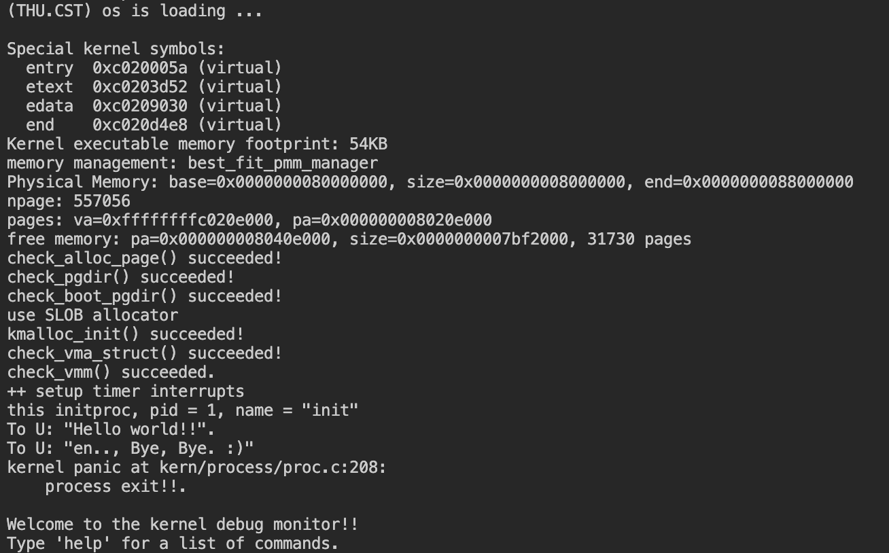
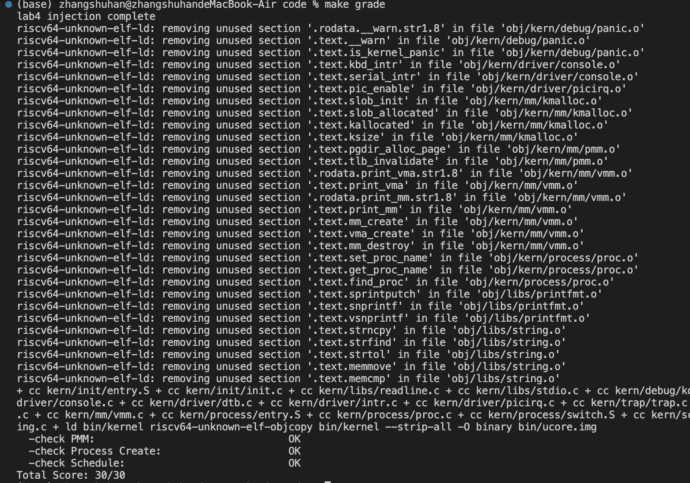

# 操作系统实验报告

## 目录

- [实验基本信息](#实验基本信息)
- [一、实验目的](#一实验目的)
- [二、实验环境](#二实验环境)
- [三、实验整体逻辑分析](#三实验整体逻辑分析)
- [四、实验内容与实现](#四实验内容与实现)
  - [功能模块一：虚拟内存页操作功能](#功能模块一虚拟内存页操作功能)
  - [功能模块二：进程创建及初始化功能](#功能模块二进程创建及初始化功能)
  - [功能模块三：进程调度功能](#功能模块三进程调度功能)
- [五、测试与验证](#五测试与验证)
  - [5.1 make qemu 手动运行](#51-make-qemu-手动运行)
  - [5.2 make grade 自动评分](#52-make-grade-自动评分)
- [六、Challenge 扩展练习](#六challenge-扩展练习)
  - [Q1：local_intr_save/restore 如何实现开关中断](#q1local_intr_saverestore-如何实现开关中断)
  - [Q2：Sv32 / Sv39 / Sv48 的异同](#q2sv32--sv39--sv48-的异同)
  - [Q3：get_pte 中两段相似代码的成因](#q3get_pte-中两段相似代码的成因)
  - [Q4：get_pte 将查找与分配合并，是否应该拆分](#q4get_pte-将查找与分配合并是否应该拆分)
- [七、实验总结与收获](#七实验总结与收获)
  - [对操作系统的理解](#对操作系统的理解)
  - [AI 协作开发的经验](#ai-协作开发的经验)

---

## 实验基本信息

| 项目 | 内容 |
|------|------|
| **实验名称** | Lab 4: 进程管理 |
| **小组成员** | 2413157-张书晗、2411514-蒲富坤、2412888-刚栋冰 |
| **完成日期** | 2026-11-19 |

### 小组分工

| 成员 | 负责的练习/模块 |
|------|----------------|
| 2413157-张书晗 | 功能模块一（虚拟内存页操作 `page_insert`/`page_remove`）、对应报告撰写、最终报告统筹 |
| 2411514-蒲富坤 | 功能模块二（进程创建及初始化）、对应报告撰写 |
| 2412888-刚栋冰 | 功能模块三（进程调度）、扩展练习 Challenge、对应报告撰写 |

实验报告如何分工？

张书晗完成功能模块一（虚拟内存页操作）的实现与「功能模块一」章节撰写，并负责第三节整体逻辑分析、第五节测试汇总与第六节总结；蒲富坤完成功能模块二（进程创建及初始化）的实现与「功能模块二」章节撰写；刚栋冰完成功能模块三（进程调度）与扩展练习 Challenge 的解答，并撰写「功能模块三」与 Challenge 相关报告内容。

---

## 一、实验目的

1. 了解虚拟内存管理的基本结构，掌握虚拟内存的组织与管理方式
2. 了解内核线程创建/执行的管理过程
3. 了解内核线程的切换和基本调度过程

---

## 二、实验环境

| 成员 | AI 编程工具 | 底层模型 | 备注 |
|------|------------|---------|------|
| 2413157-张书晗 | Codex（Cursor插件），Claude Code（终端 Agent） | gpt-6 Astra, Claude Fable 5.1 | |
| 2411514-蒲富坤 | Claude Code（终端 Agent）, Codex（VS Code插件） | gpt-6 Astra, deepseek-v4-pro | |
| 2412888-刚栋冰 | Claude Code（终端 Agent）, Codex（VS Code插件） | gpt-6 Astra, Claude Fable 5.1 | |

构建环境：交叉工具链 `riscv64-unknown-elf-*`（10.2.0，GNU as 2.47）、模拟器 `qemu-system-riscv64`（10.2），均在 WSL 中运行。

---

## 三、实验整体逻辑分析

### 2.1 本章节的逻辑主线

Lab4 的主题是**进程管理**，要解决的问题是：在已经具备物理内存管理、页表与中断能力之后，如何让内核从只能跑一段内核代码推进到能够创建多个内核线程，并在它们之间调度、切换。

执行链：

`kern_init -> pmm_init -> pic_init/idt_init -> vmm_init -> proc_init -> cpu_idle -> schedule -> proc_run -> switch_to`

### 2.2 功能的逐步实现

本次实验的逻辑顺序是：虚拟内存页操作 → 进程创建与初始化 → 进程调度：

1. **先做功能模块一：虚拟内存页操作（`page_insert` / `page_remove`）**  
   线程最终都要落在某个地址空间上运行，若页表映射、物理页引用计数与 TLB 失效不同步，后续创建线程、切换页表都会出错，因此先保证建立映射和撤销映射是正确的。

2. **再做功能模块二：进程创建及初始化（`alloc_proc` / `proc_init` / `kernel_thread` / `do_fork` / `copy_thread` / `copy_mm`）**  
   有了可用的地址空间操作后，才能把能跑内核代码推进到能创建并登记多个内核线程，要得到干净的 PCB，建立 `idleproc` 与 `initproc`，并把首次运行所需的 `trapframe`/`context` 放到新线程内核栈上，只不过`copy_mm` 我们本次实验不实现，只保留接口形态，不做真实用户地址空间复制。

3. **最后做功能模块三：进程调度（`cpu_idle` / `schedule` / `proc_run` / `switch_to`）**  
   线程对象创建出来之后，还需要调度器选出下一个可运行线程，在临界区内切换 `current`、页表与寄存器上下文，只有这一步完成后，`initproc` 才能从 `idleproc` 手中接管 CPU 并真正执行。

4. **扩展练习 Challenge**  
   在上述闭环可用后，再分析 `local_intr_save`/`local_intr_restore` 如何开关中断，并结合 `get_pte` 讨论不同分页模式与函数拆分问题。

---

## 四、实验内容与实现

### 功能模块一：虚拟内存页操作功能

**负责人：** 2413157-张书晗

#### 模块功能描述

**需要实现/修改的函数：**

```c
int page_insert(pde_t *pgdir, struct Page *page, uintptr_t la, uint32_t perm); // kern/mm/pmm.c
void page_remove(pde_t *pgdir, uintptr_t la);                                 // kern/mm/pmm.c
```

**功能说明：**

- 本模块在已有多级页表框架上完成最基本的映射维护：把物理页挂到指定线性地址，以及把已有映射安全撤销。
- `page_insert` 建立或更新映射；`page_remove` 删除映射。二者共同决定线性地址最终对应哪一页物理内存，并保持「页表项内容、物理页引用计数、TLB 状态」三者同步。
- 主要场景：首次建映射、同页更新权限、替换为其他物理页、`get_pte(..., create=1)` 分配中间页表失败返回 `-E_NO_MEM`、以及无映射时 `page_remove` 幂等返回。
- 与其他模块关系：依赖已实现的 `get_pte` / `pte_create` / `tlb_invalidate` 与物理页分配器；为后续页表测试、内核映射检查和线程地址空间逻辑提供基础。本实验以 `/Volumes/T7/lab4_new` 框架为底（而非直接在 lab3 分支上改），并把 lab2/lab3 代码填回标注位置。

#### 最终提示词

````markdown
[PROMPT]
**任务**：修改 `kern/mm/pmm.c`（如声明需同步则同时修改 `kern/mm/pmm.h`），完成「虚拟内存页操作」功能模块。
本模块在已有多级页表框架上提供最基本的映射维护能力：把指定物理页挂到给定线性地址上，以及把已有映射安全撤销。
`page_insert` 负责建立或更新映射，`page_remove` 负责删除映射；二者共同决定某一线性地址最终对应哪一页物理内存，并保证物理页引用计数、页表项内容与 TLB 状态三者一致。

**操作要求**：
- 必须在项目中修改实际文件，而不是仅展示代码片段。
- 保留文件中现有代码；只在 `page_insert` / `page_remove`（及确有必要时的模块内辅助函数）的标记或空实现位置补全。
- 不得修改 `get_pte()` 的既有语义与签名（可调用，不可改写其行为约定）。
- 不得改动物理内存分配器接口的对外契约。
- 不得引入与本模块无关的功能。

**输出要求**：
- 直接进行文件操作。
- 以工程真实代码及下列 `[RELY]`、`[GUARANTEE]`、`[SPECIFICATION]` 为准。

[RELY]
#define PTE_V 0x001
#define PTE_R 0x002
#define PTE_W 0x004
#define PTE_U 0x010
#define E_NO_MEM 4
typedef uintptr_t pte_t;
typedef uintptr_t pde_t;
struct Page { int ref; uint64_t flags; unsigned int property; list_entry_t page_link; };
pte_t *get_pte(pde_t *pgdir, uintptr_t la, bool create);
pte_t pte_create(uintptr_t ppn, uint32_t perm);
struct Page *pte2page(pte_t pte);
page_ref / set_page_ref / page_ref_inc / page_ref_dec
alloc_page / free_page
tlb_invalidate / flush_tlb

[GUARANTEE]
必须实现：
```c
int page_insert(pde_t *pgdir, struct Page *page, uintptr_t la, uint32_t perm);
void page_remove(pde_t *pgdir, uintptr_t la);
```
允许添加 static 辅助函数（如 page_remove_pte）。

[SPECIFICATION]
## page_insert
**Pre-Condition**: pgdir/page/la/perm 合法；可用 get_pte(...,1) 定位或创建末级 PTE。
**Post-Condition**: 成功则 la 映射到 page 且权限为 perm，引用计数与 TLB 同步；失败返回 -E_NO_MEM 且不留半完成映射。
**Case 1**: 无旧映射 → 新建映射，ref++，TLB 失效，返回 0。
**Case 2**: 已映射到同一 page → 更新权限，引用计数自洽，TLB 失效，返回 0。
**Case 3**: 已映射到其他 page → 先撤销旧映射再建立新映射，引用计数与 check_pgdir 可观察行为一致。
**Case 4**: 无法获得末级 PTE → 返回 -E_NO_MEM。
**Requirements**: 页表项、引用计数、TLB 三者同步；只描述行为不规定唯一实现步骤。

## page_remove
**Pre-Condition**: 不假定 la 一定有有效映射。
**Post-Condition**: 有映射则删除并同步 ref/TLB；无映射则安静返回（幂等）。
````

#### 实现迭代过程

本模块的实现经历了 2 次关键迭代，过程如下：

---

##### 第一次迭代

按上述提示词生成 `page_insert` / `page_remove`（含 static `page_remove_pte`），并迁入 lab2 的 `page_init`、Best-Fit，以及 lab3 的 trap 入口/处理代码。

**遇到的问题：**
- 问题1：本机 QEMU 使用框架默认 `-device loader` 时 OpenSBI Next Address 为 0，内核进不去；改为 `-kernel` 后仍因 lab4 原始 `entry.S` 缺少 0x80000000 恒等映射与虚址跳转而在开启 Sv39 后取指死循环。
- 问题2：`check_pgdir()` 已通过，但 `check_boot_pgdir()` 在 `strcpy((void*)0x100, ...)` 处整机重启。原因是框架 `get_pte` 给非叶页表项设置了 `PTE_U`，违反 RISC-V「非叶项 R/W/X/U 必须为 0」的约定，硬件页表行走失败。

**问题解决策略：**
- 针对问题1：迁入 lab3 已验证的 `entry.S` 恒等映射 + `.Lvirt_entry` 跳转，并修正 Makefile/`grade.sh` 的 QEMU 启动参数。
- 针对问题2：将非叶项改为 `pte_create(ppn, 0)`；同步把 `check_pgdir` 中对 `boot_pgdir_va[0] & PTE_U` 的断言改为检查 `PTE_V`。

---

##### 第二次迭代

**最终结果：**

经过 2 次迭代，该模块最终：
- 编译通过且`check_alloc_page` / `check_pgdir` / `check_boot_pgdir` 全部 succeeded
- `kmalloc_init` / `check_vmm` 通过，随后进入模块二的 `proc_init`

**关键改进点总结：**
1. 增加内部函数 `page_remove_pte`：删除某个页表项时，一并完成「清页表项、减少物理页引用计数、必要时释放物理页、刷新 TLB」。`page_insert` 在替换旧映射时，以及 `page_remove` 删除映射时，都调用它，避免两处逻辑写不一致。
2. 中间级页表项只保留有效位 `PTE_V`，不要设置 `PTE_U`。若中间项带上用户位，硬件按 RISC-V 规则无法正确走页表，`check_boot_pgdir` 访问已映射的低地址会失败。
3. 本模块先用 `check_pgdir` / `check_boot_pgdir` 验证映射与引用计数；三项 `make grade` 在模块二、三完成后一并得到 `30/30`。

---

### 功能模块二：进程创建及初始化功能

**负责人：** 2411514-蒲富坤

#### 模块功能描述

**需要实现/修改的函数：**

```c
static struct proc_struct *alloc_proc(void);                                        // kern/process/proc.c
void proc_init(void);                                                               // kern/process/proc.c
int kernel_thread(int (*fn)(void *), void *arg, uint32_t clone_flags);              // kern/process/proc.c
int do_fork(uint32_t clone_flags, uintptr_t stack, struct trapframe *tf);           // kern/process/proc.c
static void copy_thread(struct proc_struct *proc, uintptr_t esp, struct trapframe *tf); // kern/process/proc.c
static int copy_mm(uint32_t clone_flags, struct proc_struct *proc);                 // kern/process/proc.c
```

**功能说明：**

- 本模块把内核从「已经能运行内核代码」推进到「已经能创建并登记多个内核线程」：`alloc_proc` 得到干净 PCB，`proc_init` 包装 idleproc 并创建 initproc，`kernel_thread` 整理线程首次运行所需的临时中断帧，`do_fork` 把内核栈、PID、链表、状态位等资源组合成可运行实体，`copy_thread` 布置 trapframe 与 context，`copy_mm` 承担地址空间处理的占位。
- 模块完成后系统里至少要存在 `idleproc` 与 `initproc` 两个关键线程，且 `initproc` 需能在后续调度中被真正切换执行。
- 关键难点是「线程生命周期状态」与「资源挂接顺序」保持一致：`alloc_proc` 必须把 PCB 置于安全空白态，避免后续误用未初始化字段；`proc_init` 中的 idleproc 直接复用当前执行现场（pid/内核栈/current 都有特殊含义）；`kernel_thread` 与 `copy_thread` 需配合 `forkret → forkrets → __trapret` 形成首次运行链路；`do_fork` 需正确处理失败清理、PID 分配、链表挂接与唤醒顺序，否则会出现资源泄漏、僵尸结构或状态错误。
- 与其他模块关系：依赖模块一的 `get_pte`/`boot_pgdir_pa` 与物理页分配器；为模块三的 `schedule`/`proc_run`/`switch_to` 提供可调度实体与首次运行现场。本模块完成后即可满足 `test_lab4_process_create` 的全部断言。

#### 最终提示词

以下是经过迭代优化后，最终成功实现该功能的提示词（完整版另存为 `lab4_module2_proc_create_prompt.md`）：

````markdown
[PROMPT]
**任务**：修改 `kern/process/proc.c`（如声明需同步则同时修改 `kern/process/proc.h`），完成「进程创建及初始化」功能模块。
本模块负责把系统中「已经能运行内核代码」推进到「已经能创建并登记多个内核线程」。`alloc_proc` 得到一个干净的进程控制块；`proc_init` 把当前执行现场包装成 idleproc 并创建第一个真正的内核线程 initproc；`kernel_thread` 把函数入口和参数整理成线程首次运行所需的临时中断帧；`do_fork` 把这些信息和内核栈、PID、链表、状态位等资源真正组合成一个可运行实体；`copy_thread` 把 trapframe 和 context 安放到新线程自己的内核栈上；`copy_mm` 在当前实验阶段承担地址空间处理接口的占位作用。

**操作要求**：
- 必须在项目中修改实际文件，而不是仅展示代码片段。
- 保留文件中现有代码；只在标记为「lab4」/「YOUR CODE」的占位位置补全。
- 不得修改 `get_pid` / `hash_proc` / `find_proc` / `setup_kstack` / `put_kstack` / `forkret` 等既有辅助函数的行为约定。
- 不得改动 `struct proc_struct`、`struct context`、`struct trapframe` 的字段定义。
- 不得引入与本模块无关的功能。

**输出要求**：
- 直接进行文件操作。
- 以工程真实代码及下列 `[RELY]`、`[GUARANTEE]`、`[SPECIFICATION]` 为准。

[RELY]
enum proc_state { PROC_UNINIT, PROC_SLEEPING, PROC_RUNNABLE, PROC_ZOMBIE };
#define PROC_NAME_LEN 15
#define MAX_PROCESS 4096
#define MAX_PID (MAX_PROCESS * 2)
#define KSTACKSIZE (2 * PGSIZE)
#define CLONE_VM 0x00000100
struct proc_struct { state, pid, runs, kstack, need_resched, parent, mm, context, tf, pgdir, flags, name, list_link, hash_link };
struct context { ra, sp, s0~s11 };
struct trapframe { gpr(struct pushregs), status, epc, badvaddr, cause };
extern struct proc_struct *idleproc, *initproc, *current;
extern char bootstack[], bootstacktop[];
extern uintptr_t boot_pgdir_pa;
kmalloc / kfree
alloc_pages / free_pages / page2kva / kva2page
get_pid / hash_proc / find_proc / set_proc_name / get_proc_name
setup_kstack / put_kstack / wakeup_proc / forkret / kernel_thread_entry / forkrets
list_init / list_add / list_next / le2proc
local_intr_save / local_intr_restore
read_csr(sstatus) / SSTATUS_SPP / SSTATUS_SPIE / SSTATUS_SIE
E_NO_MEM / E_NO_FREE_PROC

[GUARANTEE]
必须实现：
```c
static struct proc_struct *alloc_proc(void);
void proc_init(void);
int kernel_thread(int (*fn)(void *), void *arg, uint32_t clone_flags);
int do_fork(uint32_t clone_flags, uintptr_t stack, struct trapframe *tf);
static void copy_thread(struct proc_struct *proc, uintptr_t esp, struct trapframe *tf);
static int copy_mm(uint32_t clone_flags, struct proc_struct *proc);
```

[SPECIFICATION]
## alloc_proc
**Pre-Condition**: 无。
**Post-Condition**: 返回一块状态干净、字段已初始化的 PCB：state=PROC_UNINIT、pid=-1、runs=0、kstack=0、need_resched=0、parent=NULL、mm=NULL、context 清零、tf=NULL、pgdir=boot_pgdir_pa、flags=0、name 清零；内存不足返回 NULL。

## proc_init
**Pre-Condition**: pmm/vmm 已初始化；proc_list 与 hash_list 未初始化。
**Post-Condition**: proc_list 与 hash_list 初始化完毕；idleproc（pid=0、RUNNABLE、kstack=bootstack、need_resched=1、parent=NULL、mm=NULL、tf=NULL）与 initproc（pid=1、RUNNABLE、parent=idleproc、mm=NULL、context.ra 与 context.sp 非 0）都已建立，且 current=idleproc。

## kernel_thread
**Pre-Condition**: fn/arg 合法；进程系统已初始化。
**Post-Condition**: 构造临时中断帧（s0=fn、s1=arg、epc=kernel_thread_entry、status 置 SPP/SPIE 并清 SIE），调用 do_fork 返回新线程 pid 或负错误码。

## do_fork
**Pre-Condition**: 进程数未达上限。
**Post-Condition**: 依次完成 alloc_proc → setup_kstack → copy_mm → copy_thread → 挂 proc_list/hash_list（关中断）→ wakeup_proc 七步，返回子进程 pid；任一步失败则回滚已分配资源并返回负错误码。

## copy_thread
**Pre-Condition**: proc->kstack 已分配，tf 有效。
**Post-Condition**: trapframe 放到内核栈顶，a0=0，sp=esp（esp==0 时用栈顶），context.ra=forkret、context.sp=tf。

## copy_mm
**Pre-Condition**: current->mm == NULL。
**Post-Condition**: 本实验不做地址空间复制，返回 0。
````

#### 实现迭代过程

本模块的实现经历了 2 次关键迭代，过程如下：

---

##### 第一次迭代

按上述提示词生成 6 个函数，先落地「标准 7 步 do_fork + 内核栈顶布置 trapframe」的骨架。

**遇到的问题：**
- 问题1：`test_lab4_process_create` 在 `idleproc->context.ra == 0` 处断言失败。根因是 `alloc_proc` 未对 `context` 清零，残留了 kmalloc 未初始化的垃圾值。
- 问题2：`idleproc->kstack` 被误用 `setup_kstack` 分配了新页，导致 `idleproc->kstack == (uintptr_t)bootstack` 断言失败。idleproc 本应直接复用启动阶段已建立的 bootstack，而非像普通线程那样另分配内核栈。

**问题解决策略：**
- 针对问题1：在 `alloc_proc` 中用 `memset(&(proc->context), 0, sizeof(struct context))` 显式清零上下文，并同步清零 `tf`、`name`、`flags` 等字段。
- 针对问题2：`proc_init` 中把 `idleproc->kstack = (uintptr_t)bootstack`，并把 `need_resched` 置 1、`state` 置 `PROC_RUNNABLE`，使其成为「继承当前执行现场」的空闲线程而非新分配栈的线程。

---

##### 第二次迭代

**最终结果：**

经过 2 次迭代，该模块最终：
- 编译通过（`make`）
- `test_lab4_process_create` 断言全部满足（idleproc 与 initproc 的 pid/state/parent/context 等字段一致）
- `proc_init` 返回后 `current == idleproc`，`initproc` 已登记为 pid=1 的就绪线程，等待模块三调度

**关键改进点总结：**
1. 严格区分「idleproc 复用现场」与「initproc 经 do_fork 复制」两条创建路径：前者手动打 pid=0 / bootstack / need_resched，后者走完整 7 步 fork。
2. `copy_thread` 用 `(struct trapframe *)(proc->kstack + KSTACKSIZE) - 1` 把中断帧顶到内核栈顶，并设 `context.ra=forkret`、`context.sp=proc->tf`，保证首次切换能走 `forkret → forkrets → __trapret` 恢复链路。
3. `do_fork` 通过 `local_intr_save/restore` 保护「分配 pid + 挂链表 + nr_process++」这段临界区，失败路径按 kstack → proc 逆序回滚，避免泄漏。

---

### 功能模块三：进程调度功能

**负责人：** 2412888-刚栋冰

#### 模块功能描述

**需要实现/修改的函数：**

```c
void cpu_idle(void);                                         // kern/process/proc.c
void schedule(void);                                         // kern/schedule/sched.c
void proc_run(struct proc_struct *proc);                     // kern/process/proc.c
void switch_to(struct context *from, struct context *to);    // kern/process/switch.S
```

**功能说明：**

- 本模块负责把已经创建出来的内核线程真正交给 CPU 执行：`cpu_idle` 作为空闲线程的执行主体持续等待调度需求；`schedule` 从进程链表选出下一个可运行线程；`proc_run` 在安全临界区内切换当前线程、页表和执行现场；`switch_to` 完成最底层的寄存器上下文保存与恢复。
- `cpu_idle` 在 `current->need_resched` 为真时调用 `schedule()`，否则继续空转等待；它永不返回。
- `schedule` 在关中断临界区内清除 `current->need_resched`，从 `current` 的后继节点开始轮转扫描 `PROC_RUNNABLE`；扫描一周仍无候选时回退 `idleproc`；被选中线程 `runs++`，仅当 `next != current` 时调用 `proc_run`。由于 `idleproc` 不在 `proc_list` 中，以 idle 为起点时必须从链表头开始扫描。
- `proc_run` 在关中断临界区内依次更新 `current`、按需写 Sv39 `satp` 并刷新 TLB、调用 `switch_to(&prev->context, &proc->context)`。`current` 必须在 `switch_to` 之前更新，因为新线程第一次运行经 `forkret` 时需要读取 `current->tf`。
- `switch_to` 只负责保存/恢复 `ra`、`sp`、`s0~s11`，不参与调度策略判断。`struct context` 在 RV64 下各字段 8 字节，偏移依次为 `ra=0`、`sp=8`、`s0=16`、…、`s11=104`。
- 关键难点是切换过程的原子性：`schedule` 的「选择 + 切换」和 `proc_run` 的「`current` + 页表 + 现场」都必须处于 `local_intr_save/restore` 临界区，否则当前线程、页表和实际执行现场可能出现不一致。新线程第一次运行能走到正确入口，依赖模块二预先组织的 `context.ra=forkret`、`context.sp=proc->tf` 以及 `forkret → forkrets → __trapret` 恢复链路。
- 与其他模块关系：依赖模块二的 `idleproc`/`initproc`、`kernel_thread`/`copy_thread` 与首次运行现场；依赖模块一的 `get_pte`/`boot_pgdir_pa` 与页表基础设施。本模块完成后，`initproc` 才能从 `idleproc` 手中接管 CPU，`test_lab4_schedule` 的两个测试线程才能被真正调度执行。

#### 最终提示词

以下是经过迭代优化后，最终成功实现该功能的提示词（完整版另存为 `lab4_module3_sched_prompt.md`）：

````markdown
[PROMPT]
**角色**：你是熟悉 RISC-V Sv39、uCore/rcore 风格内核与上下文切换的实验工程师。

**任务**：在仓库中完成 Lab4「功能模块三：进程调度」，替换以下三处占位实现（必须修改真实文件，而不是只输出代码片段）：

- `kern/process/proc.c`：实现 `void proc_run(struct proc_struct *proc)` 与 `void cpu_idle(void)`，替换文件末尾 `//LAB4 function3 YOUR CODE` 下的占位实现。
- `kern/schedule/sched.c`：实现 `void schedule(void)`，替换文件中的占位实现。
- `kern/process/switch.S`：实现 `void switch_to(struct context *from, struct context *to)`，替换占位汇编。

**系统现状与运行链**：
- 模块二已完成：`idleproc(pid=0)` 复用 `bootstack`、`state=PROC_RUNNABLE`、`need_resched=1`、不在 `proc_list` 中；`initproc(pid=1)` 已完成 `do_fork` 登记，`context.ra=forkret`、`context.sp=proc->tf`。
- `kern/init/init.c` 最后调用 `cpu_idle()`。
- 新线程第一次被 `switch_to` 恢复后，执行 `forkret -> forkrets -> __trapret -> sret -> kernel_thread_entry -> init_main`。
- 时钟中断处理 `kern/trap/trap.c::interrupt_handler` 会把 `current->need_resched` 置 1。
- `tools/test_lab4.c::test_lab4_schedule` 在 `init_main` 开头执行：创建 2 个测试线程，然后连续 8 次 `current->need_resched = 1; schedule();`，要求两个线程都真正运行过并打印 `[Test Schedule] PASS`。测试线程自身会反复 `need_resched = 1; schedule();`。

**操作要求**：
- 只替换上述三处占位块，保留文件中其余代码与注释。
- 不得修改 `struct context` / `struct proc_struct` / `struct trapframe` 的定义、函数签名、公开头文件。
- 不得改写 `wakeup_proc`、`forkret/forkrets/__trapret`、模块一（`page_insert/page_remove/get_pte`）与模块二（`alloc_proc/proc_init/do_fork/copy_thread`）的实现。
- 不得使用 `libs/riscv.h` 中的 `lsatp()`：它是 Sv32 语义（`SATP32_MODE | pgdir >> 12`），在 Sv39 下会得到错误的 `satp`。设置 `satp` 必须参照 `kern/mm/pmm.c::enable_paging()`。
- 不要实现或修改 `do_exit`。测试线程 / `init_main` 返回后进入 `do_exit` panic 属于框架现状，不在本模块范围。
- 不新增文件、全局变量或与本模块无关的改动。

**输出要求**：
- 直接编辑文件；完成后汇报每个文件改了哪几段、为什么。
- 以工程真实代码和下列 `[RELY]`、`[GUARANTEE]`、`[SPECIFICATION]`、`[ACCEPTANCE]` 为准；如与你的通用模板冲突，以本工程事实为准。

[RELY]
// ===== 数据结构与符号（以仓库真实定义为准）=====
struct context { uintptr_t ra; uintptr_t sp; uintptr_t s0; ... uintptr_t s11; };
// RV64：字段连续存放，每个 8 字节；偏移为 ra=0, sp=8, s0=16, s1=24, ..., s11=104

struct proc_struct {
    enum proc_state state; int pid; int runs; uintptr_t kstack;
    volatile bool need_resched; struct proc_struct *parent;
    struct mm_struct *mm; struct context context; struct trapframe *tf;
    uintptr_t pgdir; uint32_t flags; char name[PROC_NAME_LEN+1];
    list_entry_t list_link; list_entry_t hash_link;
};
extern struct proc_struct *idleproc, *initproc, *current;
extern list_entry_t proc_list;
enum proc_state { PROC_UNINIT, PROC_SLEEPING, PROC_RUNNABLE, PROC_ZOMBIE };

// ===== 调度辅助 =====
local_intr_save(intr_flag);      // 保存 sstatus.SIE 到 intr_flag，若原为开则关中断
local_intr_restore(intr_flag);   // 仅当 intr_flag 为真时重新开中断；可嵌套
list_next(le);                   // 返回链表下一项
le2proc(le, list_link);          // list_entry_t* -> struct proc_struct*
// 注意：proc_list 以 &proc_list 为哨兵；idleproc 不在 proc_list 中

// ===== 页表切换 =====
extern uintptr_t boot_pgdir_pa;
#define SATP_MODE_SV39 8
#define RISCV_PGSHIFT 12
// enable_paging() 的实际写法：
//   write_csr(satp, 0x8000000000000000 | (boot_pgdir_pa >> RISCV_PGSHIFT));
// 等价写法：((uint64_t)SATP_MODE_SV39 << 60) | (proc->pgdir >> RISCV_PGSHIFT)
// satp.MODE 位于 bit[63:60]，PPN 位于低位；写 satp 后必须刷新 TLB
static inline void flush_tlb(void) { asm volatile("sfence.vma"); }

// ===== 首次运行链路 =====
// switch_to 恢复 context 后：forkret() -> forkrets(current->tf)
// -> __trapret(RESTORE_ALL + sret) -> kernel_thread_entry -> fn(arg)
// 因此 switch_to 只需忠实保存/恢复 ra, sp, s0-s11

// ===== 测试语义 =====
// test_lab4_schedule 连续 8 次直接调用 schedule()，要求两个测试线程都被调度到；
// 每个测试线程也会主动让出 CPU。调度必须是轮转的，且无死循环。
// grade 还要求输出：[Test Schedule] PASS

[GUARANTEE]
必须实现且仅实现以下函数（签名不可变）：
```c
void cpu_idle(void);                                          // kern/process/proc.c
void proc_run(struct proc_struct *proc);                      // kern/process/proc.c
void schedule(void);                                          // kern/schedule/sched.c
void switch_to(struct context *from, struct context *to);     // kern/process/switch.S
```

[SPECIFICATION]

## switch_to
**Pre-Condition**: `from`、`to` 非空；`from->` 可写；调用发生在内核态。
**Post-Condition**:
- 把当前线程的 `ra`、`sp`、`s0~s11` 按 `struct context` 的字段顺序存入 `from`；
- 从 `to` 载入 `ra`、`sp`、`s0~s11`；
- 执行 `ret` 后控制流到达 `to->ra`，此时 `sp` 已是目标线程的栈。
**Requirements**:
- 进入函数时的 `sp` 必须先被保存再被覆盖；不要依赖当前栈保存中间值。
- 只允许使用 `a0`/`a1` 和 caller-saved 暂存寄存器；不得破坏目标的 `s0~s11`。
- 不参与调度策略判断，不访问 `proc_list`、不调用 C 函数。

## schedule
**Pre-Condition**: `current != NULL`；`proc_list` 已初始化；调用者允许被抢占。
**Post-Condition**:
- 进入临界区后先把 `current->need_resched = 0`；
- 从 `current` 在 `proc_list` 中的下一个节点开始轮转扫描，选出 `state == PROC_RUNNABLE` 的线程；
- 若扫描一周仍无候选，选择 `idleproc`；
- 被选中线程 `runs++`；
- 若选中线程不等于 `current`，调用 `proc_run(next)`；
- 选择与切换全程处于 `local_intr_save/restore` 保护的临界区内。
**Requirements**:
- 扫描必须能在有限步内结束；哨兵 `&proc_list` 不是进程，不能交给 `le2proc`。
- `current == idleproc` 与 `current` 在链表中两种情况都要处理。
- 找不到可运行线程时必须有 idle 回退，不能空转或崩溃。

## proc_run
**Pre-Condition**: `proc != NULL`；`proc->state` 为 `PROC_RUNNABLE`（或 idleproc）；允许从任意内核上下文调用。
**Post-Condition**:
- 若 `proc == current`，直接返回，不做无意义切换；
- 否则在 `local_intr_save/restore` 临界区内：
  1. 令 `current = proc`；
  2. 若目标 `pgdir` 与当前页表不同，写 `satp` 为 `(SATP_MODE_SV39 << 60) | (proc->pgdir >> RISCV_PGSHIFT)`，并执行 `flush_tlb()`；
  3. 调用 `switch_to(&prev->context, &proc->context)` 完成现场切换。
**Requirements**:
- 必须先更新 `current`、再切换页表、最后 `switch_to`，保证新线程首次运行经 `forkret` 时 `current->tf` 已正确。
- 不得在切换后假设局部变量仍属于新线程；`local_intr_restore` 会在旧线程被再次调度回来时执行，这是正确的。
- 当前实验 idleproc 与 initproc 的 `pgdir` 都是 `boot_pgdir_pa`，但仍要按通用情况处理页表切换。
- 禁止在 `proc_run` 内再次调用 `schedule`。

## cpu_idle
**Pre-Condition**: `kern_init` 已调用 `intr_enable()`；`current == idleproc`。
**Post-Condition**: 永不返回；循环检查 `current->need_resched`，为真时调用 `schedule()`；无调度需求时继续等待。
**Requirements**:
- 不要无条件反复调用 `schedule()` 导致空转抢占；只在 `need_resched` 为真时调度。
- 若 `schedule()` 找不到其他可运行线程而选回 idleproc，`cpu_idle` 必须能继续循环等待。
- 保持头文件中的 `__attribute__((noreturn))` 语义，不要 return。

[ACCEPTANCE]
1. `make` 编译、链接通过，无未定义符号。
2. 运行 QEMU 后至少看到：
   - `[Test Schedule] PASS`
   - `this initproc, pid = 1, name = "init"`
   - `To U: "Hello world!!".`
   - `To U: "en.., Bye, Bye. :)"`
3. `make grade` 中 `check Schedule` 输出 OK。
4. 自检：
   - `initproc` 能从 `idleproc` 手中接管 CPU；
   - 两个测试线程都运行过，说明轮转选择有效；
   - 连续多次 `schedule()` 不会死循环、不会重复初始化临界区、不会丢失中断状态。

[TRAPS]
1. 使用 `lsatp()` 设置 Sv39 的 `satp` —— 错误，必须用 `8ULL << 60 | pa >> 12` 的写法。
2. 写 `satp` 后忘记 `flush_tlb()` / `sfence.vma`。
3. 在 `switch_to` 之后才更新 `current` —— 新线程 `forkret` 会读到旧的 `current->tf`。
4. `switch_to` 用当前栈保存中间值，或在恢复 `sp` 之后再保存旧 `sp`。
5. `schedule` 扫描时把哨兵 `&proc_list` 当成进程，或 `current == idleproc` 时从错误位置开始。
6. 忘记清 `need_resched`，导致测试线程反复抢占、无法推进。
7. 在 `schedule` 和 `proc_run` 中重复 `runs++`。
8. 把 `local_intr_restore` 放在 `switch_to` 之前 —— 临界区被提前打开。
9. 在 `proc_run` 中无条件写 `satp` 而不判断页表差异（不致命，但应说明理由）。
10. 把 `do_exit` 的 panic 当成模块三的 bug 去改，扩大改动范围。
````

#### 实现迭代过程

本模块的核心代码一次生成即通过编译与调度测试，迭代主要发生在构建/验证环境。过程如下：

---

##### 第一次迭代

按上述提示词替换三处占位：`switch_to` 保存/恢复 `ra, sp, s0~s11`；`schedule` 在关中断临界区内轮转选择；`proc_run` 更新 `current`、按需切换 `satp`、调用 `switch_to`；`cpu_idle` 检查 `need_resched` 并调度。

**遇到的问题：**
- 问题1：WSL 默认 PATH 中没有 `riscv64-unknown-elf-*`，非交互式 `bash -lc` 又不会加载 `.bashrc` 中的工具链路径，导致无法直接编译。根因是本机交叉工具链位于 `D:\OS\riscv\...`，需要显式加入 PATH。
- 问题2：首次在 WSL 中执行 `make grade` 时，`tools/grade.sh` 报 `Syntax error: ")" unexpected`。根因是该脚本在当前 Windows 克隆中为 CRLF 换行，WSL 的 dash 把 `\r` 当成命令的一部分。
- 说明：以上两个问题都属于构建/验证环境，不涉及模块三内核代码；内核本身的 `make` 已通过。

**问题解决策略：**
- 针对问题1：在 WSL 命令中显式 `export PATH="$PATH:/mnt/d/OS/riscv/riscv64-unknown-elf-toolchain-10.2.0-2020.12.8-x86_64-linux-ubuntu14/bin"`，不修改仓库文件。
- 针对问题2：仅对 `tools/grade.sh` 执行 `sed -i 's/\r$//'` 做换行转换；转换后用 `git hash-object --path=code/tools/grade.sh` 与 `git rev-parse HEAD:code/tools/grade.sh` 比对，哈希一致，说明没有内容改动。

---

##### 第二次迭代

**最终结果：**

经过实现与验证，该模块最终：
- 编译、链接通过（`make`）
- `check_alloc_page` / `check_pgdir` / `check_boot_pgdir` 继续通过
- `make grade` 三项全部 OK：`check PMM`、`check Process Create`、`check Schedule`
- 总分 `30/30`
- QEMU 输出 `[Test Schedule] PASS`，并打印 `this initproc, pid = 1, name = "init"` 与两行 `To U:` 输出
- 完整串口日志见 `./images/qemu_module3.log`

**关键改进点/核对点总结：**
1. `switch_to` 严格按 `struct context` 的偏移 `0/8/16/…/104` 保存和恢复 `ra, sp, s0~s11`，先保存 `from` 的全部字段再恢复 `to`，且不在切换后的栈上保存中间值。
2. `schedule` 处理了 `idleproc` 不在 `proc_list` 中的特殊情况：以 idle 为起点时从链表头扫描，否则从 `current` 的后继开始；扫描遇到哨兵 `&proc_list` 时跳过，保证有限步终止；无候选时回退 `idleproc`。
3. `proc_run` 的顺序固定为 `current = proc` → 按需写 `satp` + `flush_tlb()` → `switch_to`；`satp` 使用 Sv39 格式 `((uint64_t)SATP_MODE_SV39 << 60) | (pgdir >> RISCV_PGSHIFT)`，没有使用 Sv32 语义的 `lsatp()`。
4. `schedule` 与 `proc_run` 都用 `local_intr_save/restore` 保护临界区；`switch_to` 返回时 `local_intr_restore` 在旧线程被再次调度回来时执行，属于预期行为。
5. `do_exit` 的 panic 是框架占位（`kern/process/proc.c:209`），QEMU 日志末尾出现 `kernel panic ... process exit!!.` 不影响 `make grade` 的三项检查，未扩大改动范围。

---

## 五、测试与验证

三项功能全部实现后，先 `make qemu` 观察内核启动与 initproc 运行，再 `make grade` 跑自动评分。

### 5.1 `make qemu` 手动运行

结果输出：
- 内存与页表自检通过：`check_alloc_page() succeeded!`、`check_pgdir() succeeded!`、`check_boot_pgdir() succeeded!`
- 虚拟内存初始化通过：`kmalloc_init() succeeded!`、`check_vma_struct() succeeded!`、`check_vmm() succeeded!`
- 创建并调度到 initproc：`this initproc, pid = 1, name = "init"`
- initproc 打印：`To U: "Hello world!!".`、`To U: "en.., Bye, Bye. :)"`
- 随后进入框架占位实现：`kernel panic at kern/process/proc.c:208: process exit!!.`，并落入 kernel debug monitor



### 5.2 `make grade` 自动评分

`make grade` 会注入 lab4 测试后重新编译并评分，结果：

```text
  -check PMM:                                OK
  -check Process Create:                     OK
  -check Schedule:                           OK
Total Score: 30/30
```



---

## 六、Challenge 扩展练习

> 分析范围：`kern/sync/sync.h`、`kern/driver/intr.c`、`libs/riscv.h`、`kern/trap/trapentry.S`、`kern/mm/mmu.h`、`kern/mm/pmm.c`、`kern/init/entry.S`。以下结论均以本仓库真实代码为依据，引用格式为 `文件:行号`。

### 结论摘要

1. `local_intr_save/restore` 的本质是「保存 `sstatus.SIE` 原值 → 必要时关中断 → 恢复原值」，不是无条件开/关中断；因此可嵌套，也不会在原本关中断的上下文里错误地打开中断。
2. Sv32/Sv39/Sv48 的页表遍历算法相同，差异集中在虚拟地址位宽、页表级数、VPN 划分、PTE 大小、`satp.MODE` 与大页层级。
3. `get_pte` 中两段相似代码，是 Sv39 三个层级中「根页表以下两级」的同一套「查表项 → 缺表则分配 → 填非叶 PTE → 下降」操作的手工展开；本工程根页表是静态构建的，所以恰好只有两段。
4. `get_pte` 把「查找」和「按需分配」合并在一个函数里，在本实验规模下可用，但存在 `NULL` 语义二义、分配失败不回滚、不识别大页叶子等缺陷。建议本实验保持接口不变、内部重构；从内核设计角度应拆分。
5. 本工程的启动页表用 1 GiB 叶大页映射内核区，`get_pte` 会把这种叶大页误当成下一级页表指针，因此不能对内核高半址的大页区间调用 `get_pte`；`check_boot_pgdir` 已经显式跳过该遍历。

---

### Q1：`local_intr_save/restore` 如何实现开关中断

#### 1.1 代码事实

```c
// kern/sync/sync.h:8-26
static inline bool __intr_save(void) {
    if (read_csr(sstatus) & SSTATUS_SIE) {
        intr_disable();
        return 1;
    }
    return 0;
}

static inline void __intr_restore(bool flag) {
    if (flag) {
        intr_enable();
    }
}

#define local_intr_save(x) \
    do {                   \
        x = __intr_save(); \
    } while (0)
#define local_intr_restore(x) __intr_restore(x);
```

```c
// kern/driver/intr.c:5-8
void intr_enable(void) { set_csr(sstatus, SSTATUS_SIE); }
void intr_disable(void) { clear_csr(sstatus, SSTATUS_SIE); }
```

`SSTATUS_SIE` 是 S 态全局中断使能位，定义于 `libs/riscv.h:46`（`0x00000002`）。`read_csr/set_csr/clear_csr` 分别展开为 `csrr / csrrs / csrrc` 指令（`libs/riscv.h:210-225`）。

#### 1.2 返回值语义

`__intr_save()` 的返回值不是「是否成功关中断」，而是「进入临界区之前，中断是否本来是开着的」：

| 进入前 `SIE` | `__intr_save()` 返回 | 返回后 `SIE` | `local_intr_restore(flag)` 行为 |
|---|---|---|---|
| 1（开） | 1 | 0（已关） | `flag == 1`，重新置 1 |
| 0（关） | 0 | 0（不变） | `flag == 0`，什么也不做 |

因此它实现的是「保存并恢复原状态」，而不是「先关后无条件开」。

#### 1.3 为什么不能直接调用 `intr_disable()/intr_enable()`

如果写成：

```c
intr_disable();
/* critical section */
intr_enable();
```

会有两个问题：

1. **丢失调用者原有状态**：调用者可能本来就在关中断上下文中（例如 trap 处理、另一个临界区内部）。无条件 `intr_enable()` 会提前打开中断，破坏外层临界区。
2. **不可嵌套**：内层临界区结束后会把中断打开，外层剩余部分不再原子。

`local_intr_save/restore` 通过返回旧 `SIE` 解决这两个问题。嵌套示例：

```c
bool a, b;
local_intr_save(a);   // a = 1，SIE: 1 -> 0
    local_intr_save(b); // b = 0，SIE 仍为 0
    local_intr_restore(b); // b == 0，不做任何事
local_intr_restore(a); // a == 1，SIE: 0 -> 1
```

内层不会误开中断，外层结束时才恢复到进入前的状态。

#### 1.4 与 trap 入口/返回的配合

RISC-V 硬件在发生 trap 时会把 `SIE` 存入 `SPIE`，并清零 `SIE`；`sret` 返回时再从 `SPIE` 恢复 `SIE`。本工程的 trap 入口/出口显式保存和恢复了整个 `sstatus`：

- `SAVE_ALL` 把 `sstatus` 保存到 trapframe：`kern/trap/trapentry.S:42-52`；
- `RESTORE_ALL` 在恢复通用寄存器之前把 `sstatus` 写回：`kern/trap/trapentry.S:58-63`；
- `__trapret` 最后执行 `sret`：`kern/trap/trapentry.S:114-118`。

这带来两个关键性质：

- 如果 trap 发生在临界区内部（`SIE == 0`），硬件保存的 `SPIE == 0`，`sret` 返回后 `SIE` 仍为 0，临界区不会被意外打开；
- 如果 trap 发生在临界区外部（`SIE == 1`），`SPIE == 1`，`sret` 返回后中断恢复使能。

如果 trap 路径只保存通用寄存器而不保存 `sstatus`，`sret` 就可能把临界区内部的中断重新打开，原子性被破坏。这正是「保存现场」不仅是保存 GPR 的原因。

#### 1.5 宏实现的一个潜在问题

`local_intr_save` 使用了标准的 `do { ... } while (0)` 包装，但：

```c
#define local_intr_restore(x) __intr_restore(x);
```

它没有 `do { ... } while (0)`，而且分号写在宏内部。若这样使用：

```c
if (cond)
    local_intr_restore(flag);
else
    ...
```

展开后等价于：

```c
if (cond)
    __intr_restore(flag);;
else
    ...
```

会出现「`else` 没有匹配的 `if`」的编译错误，或者在更复杂的宏上下文中产生悬挂 `else` 风险。本仓库的调用点都把 `local_intr_restore` 当作独立语句使用（例如 `kern/schedule/sched.c`、`kern/process/proc.c`），所以当前不会触发；但从宏设计角度，应写成：

```c
#define local_intr_restore(x) do { __intr_restore(x); } while (0)
```

#### 1.6 与功能模块三的关系

`schedule` 在「清 `need_resched` → 选下一个线程 → 调 `proc_run`」全程使用 `local_intr_save/restore`；`proc_run` 在「更新 `current` → 切换 `satp` → `switch_to`」全程使用同一对宏。原因是这三步必须对外表现为一个原子动作：

- 若在选出 `next` 之后、切换之前被时钟中断打断，可能再次进入 `schedule`，造成 `current`、页表、内核栈三者不一致；
- `proc_run` 中 `current`、`satp`、`sp/ra` 的更新顺序也不能被中断插入。

注意：`switch_to` 返回时，代码已经运行在**旧线程**被再次调度回来的上下文中，所以 `proc_run` 末尾的 `local_intr_restore(intr_flag)` 会在旧线程恢复执行时执行，这是预期行为。新线程第一次运行走的是 `forkret → forkrets → __trapret → sret`，由 trapframe 中的 `sstatus` 恢复中断状态（`kernel_thread` 在 `kern/process/proc.c:303-305` 中设置 `SPP/SPIE` 并清 `SIE`），不会永久继承关中断状态。

---

### Q2：Sv32 / Sv39 / Sv48 的异同

#### 2.1 对比表

| 项目 | Sv32 | Sv39 | Sv48 |
|---|---|---|---|
| 适用架构 | RV32 | RV64 | RV64 |
| 虚拟地址位宽 | 32 | 39 | 48 |
| 页表级数 | 2 | 3 | 4 |
| VPN 划分（高位→低位） | 10 + 10 | 9 + 9 + 9 | 9 + 9 + 9 + 9 |
| 页内偏移 | 12 | 12 | 12 |
| PTE 大小 | 4 字节 | 8 字节 | 8 字节 |
| 每张 4 KiB 页表项数 | 1024 | 512 | 512 |
| PTE 中 PPN 位宽 | 22 | 44 | 44 |
| 物理地址位宽 | 34 | 56 | 56 |
| `satp.MODE` | 1 | 8 | 9 |
| 可映射页大小 | 4 KiB、4 MiB | 4 KiB、2 MiB、1 GiB | 4 KiB、2 MiB、1 GiB、512 GiB |
| 虚拟地址空间 | 4 GiB | 2^39 = 512 GiB | 2^48 = 256 TiB |
| 地址规范化 | 无 | bit[63:39] 必须等于 bit[38] | bit[63:48] 必须等于 bit[47] |

补充：Sv57 为 5 级、57 位 VA、`MODE=10`；Sv64 为 6 级、`MODE=11`。本实验使用 Sv39（`libs/riscv.h:140`）。

#### 2.2 `satp` 布局与本工程的写法

RISC-V 的 `satp` 在 RV32 与 RV64 下布局不同，本仓库的宏定义给出了字段位置（`libs/riscv.h:131-143`）：

| 字段 | RV32（Sv32） | RV64（Sv39/48/57） |
|---|---|---|
| MODE | bit[31] | bit[63:60] |
| ASID | bit[30:22]（9 位） | bit[59:44]（16 位） |
| PPN | bit[21:0]（22 位） | bit[43:0]（44 位） |

本工程 `enable_paging()` 的写法是：

```c
// kern/mm/pmm.c:158-161
write_csr(satp, 0x8000000000000000 | (boot_pgdir_pa >> RISCV_PGSHIFT));
```

`0x8000000000000000` 就是 `8 << 60`，即把 MODE 置为 8（Sv39）。`libs/riscv.h:245-248` 的 `lsatp()` 则是：

```c
write_csr(satp, SATP32_MODE | (pgdir >> RISCV_PGSHIFT)); // SATP32_MODE = 0x80000000
```

它只设置 bit[31]，在 RV64 的 `satp` 中 MODE 字段位于 bit[63:60]，因此 MODE 实际为 0；同时参数是 32 位，PPN 高位也会丢失。所以 `lsatp()` 在 Sv39 实验中不可用，必须使用 `enable_paging()` 的写法（或在 `proc_run` 中用 `((uint64_t)SATP_MODE_SV39 << 60) | (pgdir >> 12)`）。

另外，写 `satp` **不会**自动刷新 TLB。本工程在设置 `satp` 后执行 `sfence.vma`：

- 启动阶段：`kern/init/entry.S:24-31`；
- 整页刷新：`flush_tlb()`，`kern/mm/pmm.h:164-167`；
- 按地址刷新：`tlb_invalidate()`，`kern/mm/pmm.c:360-367`。

#### 2.3 页表遍历的统一算法

三种模式下，页表遍历的逻辑完全一致，只是级数和 VPN 位宽不同：

```text
table = satp.PPN << 12
for level = 最高级 downto 0:
    pte = table[VPN[level]]
    if (!pte.V)                 -> page fault
    if (pte.R | pte.W | pte.X)  -> 叶子项，停止
    table = pte.PPN << 12       -> 继续下一级
```

叶子项对应的物理地址由「叶子 PTE 的 PPN + 虚拟地址中尚未使用的低位」拼成。非叶 PTE 的 `R/W/X` 必须为 0，只保留 `V`（以及规范允许的位）；本工程 `get_pte` 用 `pte_create(page2ppn(page), 0)` 填非叶项（`kern/mm/pmm.c:260`、`kern/mm/pmm.c:275`），只置 `V`，这是正确的。

#### 2.4 本工程为什么用 `PDX1`、`PDX0`、`PTX`

`kern/mm/mmu.h:28-32`、`kern/mm/mmu.h:56-59` 定义了三个 9 位索引：

| 宏 | 位移 | 掩码 | Sv39 对应 |
|---|---|---|---|
| `PDX1(la)` | `>> 30` | `0x1FF` | VPN[2]，bit[38:30] |
| `PDX0(la)` | `>> 21` | `0x1FF` | VPN[1]，bit[29:21] |
| `PTX(la)` | `>> 12` | `0x1FF` | VPN[0]，bit[20:12] |

`PTSIZE` 为 `4096 * 512 = 2 MiB`（`kern/mm/mmu.h:53`），正好对应 Sv39 中「一级页表项作为叶子时映射 2 MiB」的粒度。

需要注意：`kern/mm/mmu.h:8-25` 顶部的注释仍然是 **Sv32/x86 风格** 的「10 + 10 + 12」和 Sv32 PTE 布局，与下面实际使用的 9 + 9 + 9 宏不一致，是历史遗留注释。阅读时应以宏定义和 `kern/init/entry.S` 的 Sv39 构建代码为准。

#### 2.5 本工程启动页表的具体映射

`kern/init/entry.S:66-77` 构建了 `boot_page_table_sv39`，其中两个有效项都是 **1 GiB 叶大页**：

```asm
.zero 8 * 2
.quad (0x80000 << 10) | 0xcf   # VPN2=2，VA 0x80000000 恒等映射到 PA 0x80000000
.zero 8 * (511 - 3)
.quad (0x80000 << 10) | 0xcf   # VPN2=511，内核高半址映射到 PA 0x80000000
```

`0xcf = V|R|W|X|A|D`（没有置 `G`），`0x80000 << 10` 是 PPN=0x80000，即 PA=0x80000000。

本工程 `KERNBASE = 0xFFFFFFFFC0200000`、`PHYSICAL_MEMORY_OFFSET = 0xFFFFFFFF40000000`（`kern/mm/memlayout.h:34-38`），因此 `PADDR(KERNBASE) = 0x80200000`。对 `KERNBASE` 计算：

- `VPN2 = (0xFFFFFFFFC0200000 >> 30) & 0x1FF = 511`；
- 1 GiB 叶项覆盖的 PA 基址为 `0x80000000`；
- 虚拟地址低 30 位为 `0x00200000`，所以最终 PA = `0x80000000 + 0x00200000 = 0x80200000`。

这与内核实际加载地址一致。`VPN2=2` 的恒等映射则用于 `satp` 打开后、跳转到高半址虚拟入口之前仍能取指（`kern/init/entry.S:32-39`）。

---

### Q3：`get_pte` 中两段相似代码的成因

#### 3.1 两段代码分别在做什么

`get_pte` 的完整逻辑（`kern/mm/pmm.c:243-278`）：

```c
pde_t *pdep1 = &pgdir[PDX1(la)];
if (!(*pdep1 & PTE_V)) {
    /* 分配一张 4 KiB 页作为下一级页表，清零、ref=1、挂到根页表 */
    *pdep1 = pte_create(page2ppn(page), 0);
}
pde_t *pdep0 = &((pte_t *)KADDR(PDE_ADDR(*pdep1)))[PDX0(la)];
if (!(*pdep0 & PTE_V)) {
    /* 再分配一张 4 KiB 页作为末级页表，清零、ref=1、挂到上一级页表 */
    *pdep0 = pte_create(page2ppn(page), 0);
}
return &((pte_t *)KADDR(PDE_ADDR(*pdep0)))[PTX(la)];
```

- **第一段**：`pdep1` 是根页表（由 `pgdir` 指向）中的 VPN[2] 项。若无效，分配一张页作为 **level-1 页表**，其表项将用 VPN[1]（`PDX0`）索引。
- **第二段**：`pdep0` 是 level-1 页表中的 VPN[1] 项。若无效，分配一张页作为 **level-0 页表**，其表项将用 VPN[0]（`PTX`）索引。
- 最后返回 level-0 页表中 VPN[0] 对应的**叶子 PTE 指针**，由调用者填入物理页和权限。

#### 3.2 为什么两段几乎一模一样

因为它们执行的是同一件事：

```text
在某级页表中取索引 idx 的表项
若 V == 0：
    分配一页物理页
    ref = 1
    清零
    写入非叶 PTE（PPN + V）
把「当前表」下降到该表项指向的下一级页表
```

Sv32/Sv39/Sv48 的页表都是**同构的基数树（radix tree）**，每一级的操作完全相同，区别只是：

- 当前表的基址从哪里来（根是 `pgdir`，下级是 `KADDR(PDE_ADDR(上一级项))`）；
- 用哪个 VPN 字段做索引（`PDX1` / `PDX0` / `PTX`）；
- 总共有几级。

因此，完全通用的实现可以写成一个循环：

```c
pte_t *table = pgdir;
for (level = TOP; level > 0; level--) {
    idx = VPN[level](la);
    if (!(table[idx] & PTE_V))
        table[idx] = alloc_table_pte(...);
    table = KADDR(PDE_ADDR(table[idx]));
}
return &table[VPN[0](la)];
```

当前代码只是把这个循环**手工展开**了。相似的两段正是「同构层级」的直接体现。

#### 3.3 为什么本工程只有两段，而不是 Sv39 应有的三段

Sv39 有 3 级页表：根（VPN[2]）、中间（VPN[1]）、末级（VPN[0]）。但 `get_pte` 只可能分配「根以下」的两级，因为：

- **根本身是静态提供的**：`boot_pgdir_va = boot_page_table_sv39`（`kern/mm/pmm.c:221-223`），这张 512 项页表在 `kern/init/entry.S:66-77` 的 `.data` 段中预先构建，包含恒等映射与内核高半址的两个 1 GiB 叶项。
- `get_pte` 的参数 `pde_t *pgdir` 是**按值传入的根页表指针**，函数无法替换根页表本身；它只能在根页表项无效时，在根项下挂一张新的 level-1 页表。
- 因此，能动态分配的中间层级只有 level-1 和 level-0 两层，正好对应两段代码。

一般规律是：

| 模式 | 总级数 | 根是否由调用者提供 | `get_pte` 中相似段数 |
|---|---|---|---|
| Sv32 | 2 | 是 | 1 |
| Sv39 | 3 | 是（本工程静态根） | 2 |
| Sv48 | 4 | 是 | 3 |

也就是说，**相似段数 = 总级数 - 1**。如果将来改为 Sv48，按当前写法应再增加一段（VPN[2] → level-2 表）；更好的做法是改成上面的循环。

#### 3.4 如果根页表也允许动态创建

当前 `get_pte` 无法创建根页表，因为 `pgdir` 是按值传入的指针。若允许动态根，需要：

1. 把接口改成 `pde_t **pgdir`，或先由 `mm_create` / `pgdir_alloc_page` 分配根页表再传入；
2. 在 `get_pte` 内增加「根项 → level-2 表」的分配段（Sv48 还要再多一级）；
3. 或者统一改成按 `VPN` 数组循环的版本，根分配放在循环之前由调用者完成。

#### 3.5 一个关键边界：大页叶子会被误当成下一级页表

`get_pte` 只检查 `PTE_V`，**没有检查当前项是否是叶子项**（`R/W/X` 是否为 0）。于是：

- 若某一级表项是启动页表中的 1 GiB 叶大页，`V=1`，代码不会分配，而是直接执行
  `KADDR(PDE_ADDR(*pdep1))`，把该叶项的 PPN 当作下一级页表物理地址。
- 以本工程为例，启动页表项 `(0x80000 << 10) | 0xcf` 的 PPN 是 `0x80000`，`PDE_ADDR` 得到 `0x80000000`；`KADDR(0x80000000)` 得到 `0xFFFFFFFFC0000000`，这落在内核高半址映射区，指向内核代码/数据，而不是一张页表。继续读写它就会把内核内存当作页表项破坏。

这正是 `check_boot_pgdir` 中框架注释说明的问题：

```c
// kern/mm/pmm.c:445-449
 * 框架修正：原循环用 int 遍历 KERNBASE，且启动页表是 1GiB 叶大页，
 * get_pte 会把大页项误当成次级页表页。模块一的 4KiB 映射正确性已由
 * check_pgdir 覆盖；此处跳过该大页遍历，直接做低地址 insert/访问测试。
```

本工程当前的 `get_pte` 调用点只使用低地址（`0x0`、`PGSIZE`、`0x100`、`0x100 + PGSIZE` 等），这些地址的根项要么无效（由 `get_pte` 新建表），要么是 4 KiB 映射；`boot_map_segment` 虽然会以 `create=1` 调 `get_pte`（`kern/mm/pmm.c:178`），但当前代码中没有调用它。因此实际运行不会踩到上述大页路径。但这说明 `get_pte` 不是通用的页表遍历器：一旦要在内核 1 GiB 大页区间内建立 4 KiB 映射，就必须先拆分大页，或者换成能识别叶子项的 walker。

#### 3.6 非叶 PTE 的权限位

RISC-V 规定非叶 PTE 的 `R/W/X` 必须为 0；本工程 `get_pte` 用 `pte_create(page2ppn(page), 0)` 只置 `V`（`kern/mm/pmm.c:260`、`kern/mm/pmm.c:275`），并在 `kern/mm/pmm.c:256-259` 的注释中说明：如果非叶项带 `U` 或 `R/W/X`，`check_boot_pgdir` 中对 VA `0x100` 的真实访问会因硬件页表行走失败而缺页重启。这与 Sv32/Sv39/Sv48 的共同规则一致。

---

### Q4：`get_pte` 将查找与分配合并，是否应该拆分

#### 4.1 当前接口与调用方式

```c
pte_t *get_pte(pde_t *pgdir, uintptr_t la, bool create);
```

本仓库的调用点（`grep` 结果均位于 `kern/mm/pmm.c`）：

| 调用点 | `create` | 用途 |
|---|---|---|
| `boot_map_segment` `kern/mm/pmm.c:178` | 1 | 建立启动映射，需要创建页表 |
| `get_page` `kern/mm/pmm.c:284` | 0 | 只查找，用于查询某地址对应的 `struct Page` |
| `page_remove` `kern/mm/pmm.c:318` | 0 | 只查找，删除已有映射 |
| `page_insert` `kern/mm/pmm.c:326` | 1 | 建立/更新映射，需要创建页表 |
| `check_pgdir` `kern/mm/pmm.c:393,399,403,416` | 0 | 验证查找结果 |

`get_page`、`page_remove` 已经通过 `create=0` 获得了「纯查找」语义，说明当前设计并非完全没有区分；但区分方式只是一个布尔参数。

#### 4.2 合并写法的优点

1. **调用者简单**：`page_insert`/`boot_map_segment` 一次调用就能拿到可写的叶子 PTE，不需要自己逐级分配。
2. **集中维护不变量**：页表页的 `ref=1`、清零、非叶项只置 `V` 等规则只在一个函数里实现，避免调用者重复写错。
3. **减少代码量**：对教学内核而言，少一层抽象，便于阅读。
4. `create=0` 时确实可以当查找函数用，覆盖了 `get_page`/`page_remove` 的需求。

#### 4.3 合并写法的问题

1. **`NULL` 返回值语义二义**  
   - `create=0` 时，`NULL` 表示「中间页表不存在 / 地址未映射」；  
   - `create=1` 时，`NULL` 表示「`alloc_page` 失败（内存不足）」。  
   调用者无法区分「没有映射」和「分配失败」。`page_insert` 只能把两者都映射为 `-E_NO_MEM`（`kern/mm/pmm.c:326-329`）；`page_remove`/`get_page` 则把两者都当作「没有映射」处理。对错误处理和诊断都不利。

2. **查找函数带隐藏副作用**  
   函数名是 `get_pte`，但 `create=1` 时会分配物理页、改页表、增加引用计数。若调用者本意只是查询，却误传 `create=1`，就会产生不必要的分配；代码审阅时也不容易看出「查询」路径是否可能分配。

3. **分配失败不回滚，可能泄漏页表页**  
   第一段若已分配 level-1 页表并挂到根项，第二段 `alloc_page` 失败时直接 `return NULL`，已分配的 level-1 页表仍以 `ref=1` 挂在根页表上，没有回收。当前 `page_insert` 失败路径只返回错误，不会释放它。  
   此外，`page_remove`/`page_remove_pte` 只释放映射的**数据页**（`kern/mm/pmm.c:303-314`），不会释放页表页；页表页一旦建立就一直存在。`check_pgdir` 在末尾手动 `free_page(pde2page(...))` 两张页表页并断言空闲页数量恢复（`kern/mm/pmm.c:430-436`），正说明页表页需要显式回收。

4. **缺少并发/中断保护**  
   `get_pte` 的「检查 `V` → 分配 → 写入」不是原子操作，函数本身也没有加锁。当前实验是单 hart、主要在初始化阶段调用，问题不明显；但在 SMP 或允许中断重入的场景下，两个 walker 可能同时看到 `V=0` 并各自分配一张页表，造成泄漏或覆盖。

5. **不识别叶子项/大页**  
   如 Q3.5 所述，函数只检查 `V`，不检查 `R/W/X`。遇到 1 GiB/2 MiB 叶大页时会把叶项当表指针，既不能正确拆分大页，也不能安全返回错误。这使它无法作为通用的页表 walker 使用。

6. **难以测试和错误注入**  
   没有错误码、没有「本次分配了哪些页表页」的输出，失败路径难以精确测试；也不便于实现按需分页、预分配策略或内存配额。

#### 4.4 拆分方案

一种清晰的分层是：

```c
/* 纯查找：不分配，不修改页表 */
pte_t *walk_pte(pde_t *pgdir, uintptr_t la);          // 无映射返回 NULL

/* 创建：必要时分配，返回 0 / -E_NO_MEM */
int alloc_pte(pde_t *pgdir, uintptr_t la, pte_t **ptep);
```

或者保留一个返回值更丰富的版本：

```c
enum pte_result { PTE_ABSENT, PTE_PRESENT, PTE_HUGE, PTE_BAD };
enum pte_result get_pte_ex(pde_t *pgdir, uintptr_t la, bool create,
                           pte_t **ptep);
```

拆分后的分工：

- `page_remove` / `get_page` 使用 `walk_pte`，绝不分配；
- `page_insert` / `boot_map_segment` 使用 `alloc_pte`，失败时能得到明确的 `-E_NO_MEM`，并按需回滚已分配的页表页；
- 页错误处理可以在 `walk_pte` 判定 `PTE_ABSENT` 后，再调用 `alloc_pte`，符合「先判断、后分配」的常见内核流程；
- 大页可以在 walker 中返回 `PTE_HUGE`，由上层决定拆分或拒绝。

代价：

- 接口变多，调用者需要选择；
- 若调用者先 `walk` 再 `alloc`，可能遍历两次；
- 教学实验中需要同步修改调用点和测试。

#### 4.5 结论

- **对本实验**：建议**保持 `get_pte(pgdir, la, create)` 的签名不变**。原因有三：模块一的规格明确要求不改变 `get_pte` 的既有语义；现有调用点（`page_insert/page_remove/get_page/check_*`）和测试都依赖这个接口；改动接口会扩大与本模块无关的改动范围。  
  但可以在函数内部做低风险重构：把两段重复逻辑抽成一个按级循环或 `get_pte_level(table, idx, create, &err)` 辅助函数，并在失败时回滚已分配的页表页、区分「不存在」与「内存不足」。
- **从内核设计角度**：应该拆分「查找」和「分配」。生产内核（如 Linux）通常把页表遍历（`pgd_offset`/`p4d_offset`/...、`follow_pte`）与缺页/分配处理（`handle_pte_fault`、`__pte_alloc`）分开，并配合锁、错误码、大页和迁移机制。合并写法适合规模很小的教学内核，但不是通用的页表抽象。
- **一句话**：接口上可以保留 `create` 布尔参数作为教学折中；实现上应把「每级操作」抽象掉，并把「不分配」与「分配失败」用返回码区分开。是否拆成两个公开函数，取决于是否愿意为此修改调用者；本实验不建议改公开接口。

---

### 本实验的具体结论（与功能模块三的衔接）

1. **开关中断**：`schedule` 和 `proc_run` 用 `local_intr_save/restore` 包住「选择 + `current` 更新 + `satp` 切换 + `switch_to`」，保证调度决策与执行现场切换原子。`switch_to` 本身不保存 `sstatus`；第一次运行由 `forkrets → __trapret → sret` 从 trapframe 恢复中断状态，后续运行由各线程自己的 `local_intr_restore` 恢复。
2. **Sv39 页表切换**：`proc_run` 写 `satp` 时使用 `(SATP_MODE_SV39 << 60) | (pgdir >> 12)`，并在写后 `flush_tlb()`；不能使用 `lsatp()`。本实验所有线程共享 `boot_pgdir_pa`，所以实际不会频繁触发页表切换，但通用逻辑必须正确。
3. **根页表与 `get_pte` 的边界**：启动页表是静态的 Sv39 根表，内核区由 1 GiB 叶大页覆盖。`get_pte` 只适用于根表以下、需要 4 KiB 粒度映射的低地址区域；不要对内核 1 GiB 大页区间调用它。`check_boot_pgdir` 已经为此跳过 KERNBASE 遍历。
4. **接口取舍**：本实验保留 `get_pte` 的 `create` 参数；若后续要实现用户态按需分页或大页拆分，应先把页表遍历与页表分配拆开，并补上锁、错误码和页表页回收。

### 未确认点

- 本文的 `satp` 字段宽度、PTE 位布局与大页大小来自 RISC-V Privileged Spec 的通用定义，并与仓库 `libs/riscv.h:131-143`、`kern/mm/mmu.h` 的宏一致；若报告要求逐字引用规范，建议再核对所用版本的 Spec 原文。
- `check_boot_pgdir` 的注释明确说明「`get_pte` 会把 1 GiB 叶大页误当次级页表页」；本文通过代码路径确认了这一点，但没有实际触发该破坏性路径（触发会导致内核内存被当作页表改写）。
- `boot_map_segment` 当前在仓库中没有调用点；如果未来恢复调用并对高半址内核区间建映射，需要先处理大页拆分，否则会触发上述问题。

---

## 七、实验总结与收获

### 对操作系统的理解

#### 1. 本实验的要点及其与操作系统原理的对应

**（1）进程控制块（PCB）的设计与实现**

- 实验内容：`struct proc_struct` 包含 `state`、`pid`、`kstack`、`context`、`trapframe`、`mm`、`pgdir` 等字段；PCB 用 `kmalloc` 在内核堆分配，内核栈由 `setup_kstack` 分配物理页。
- 原理对应：PCB 记录进程状态与资源；进程由程序、执行状态与资源共同构成。
- 说明：`proc_struct` 把理论中的抽象落到具体数据结构上；实验对文件表、信号等复杂字段作了简化。

**（2）进程状态转换与调度**

- 实验内容：状态集合为 `PROC_UNINIT`、`PROC_RUNNABLE`、`PROC_SLEEPING`、`PROC_ZOMBIE`；相关函数包括 `wakeup_proc`、`proc_run`；调度时遍历 `proc_list` 选择可运行进程。
- 原理对应：五状态模型（新建、就绪、运行、阻塞、终止）及常见调度算法（FCFS、优先级、时间片轮转）。
- 说明：实验简化为四状态并用线性扫描调度，重点在机制而非性能；后续可扩展优先级或时间片。

**（3）上下文切换（Context Switch）**

- 实验内容：`struct context` 保存被调用者保存寄存器（`ra`、`sp`、`s0`–`s11`）；`switch_to` 汇编完成保存/恢复；`proc_run` 先切页表再切上下文。
- 原理对应：切换步骤包括保存现场、选择进程、恢复现场；上下文含寄存器、PC、栈指针和页表基址等。
- 说明：实验区分 `context`（用于切换）与 `trapframe`（用于中断/异常返回），并依赖 RISC-V 调用约定管理寄存器。

**（4）进程创建（fork）**

- 实验内容：`do_fork` 分配 PCB、内核栈并布置 `trapframe`/`context`；`copy_thread` 设置子进程初始返回值与执行环境；通过寄存器区分父子返回值。
- 原理对应：`fork` 创建进程副本，通常可结合写时复制（COW）降低开销。
- 说明：本次主要针对内核线程（共享地址空间），`copy_mm` 未实现用户空间复制；真正的用户级 `fork` 与 COW 需后续扩展。

**（5）虚拟内存与分页机制**

- 实验内容：完成 `page_insert`/`page_remove`；依赖 Sv39 三级页表、`get_pte` 按需分配中间页表、页表项标志位（`V`/`R`/`W`/`X`/`U` 等）以及 `KADDR`/`PADDR` 等地址转换。
- 原理对应：虚拟内存提供地址隔离与按需分页，多级页表降低页表占用，TLB 加速地址转换。
- 说明：实验要求映射建立/撤销时同步维护引用计数并刷新 TLB；中间级页表项不得带 `PTE_U`，否则硬件页表行走会失败。

**（6）临界区保护与中断管理**

- 实验内容：`local_intr_save`/`local_intr_restore` 通过读写 `sstatus` 的 SIE 位开关中断，并保存原始中断状态以支持嵌套保护。
- 原理对应：临界区互斥、同步原语，以及最底层的关中断机制。
- 说明：关中断是单核内核中最直接的同步手段；多核还需更细粒度同步（如自旋锁）。

**（7）内核栈与用户栈**

- 实验内容：每个进程经 `setup_kstack` 获得独立内核栈，用于保存 `trapframe` 与内核调用链；`proc->tf` 指向栈上的 `trapframe`。
- 原理对应：用户栈与内核栈分属不同特权级，切换时需更换栈指针以保护内核。
- 说明：本实验主要为内核线程分配内核栈，用户态栈相关内容在后续实验补充。

**（8）进程标识符（PID）管理**

- 实验内容：`get_pid` 遍历 `proc_list` 保证 PID 唯一，并用 `last_pid`、`next_safe` 优化查找；支持回收但避免与现存进程冲突。
- 原理对应：PID 是进程唯一标识，需有分配与回收策略。
- 说明：当前为线性分配/回收；生产系统可能使用位图等更高效结构。

#### 2. 原理中重要但本实验未覆盖的内容

1. **完整进程退出与回收**：真实的 `do_exit`、父进程 `wait`、僵尸进程回收等（本实验 `do_exit` 仍是 panic 占位）。
2. **进程间通信（IPC）**：管道、消息队列、共享内存、套接字等；本实验聚焦创建与调度。
3. **优先级与多级反馈队列调度**：当前调度器实现简单，后续可加优先级字段与多队列。
4. **多核（SMP）支持**：负载均衡、锁扩展与缓存一致性；实验在单核环境简化。
5. **实时调度**：对时延有严格要求的策略与时钟管理，超出本次基础范围。
6. **用户级线程与轻量级进程**：本实验以内核线程为主。
7. **写时复制（COW）与缺页/置换**：需配合页错误处理；当前未实现 `copy_mm`。
8. **信号机制**：异步通知、信号栈与掩码管理。
9. **进程组与会话 / 守护进程 / 资源限制（ulimit）**：作业控制、后台服务与资源配额等更高层管理功能。
10. **系统调用与用户程序加载（exec）**：从用户态进入内核并加载可执行文件的完整路径，通常在后续实验出现。

### AI 协作开发的经验

1. **提示词要写系统必须满足什么，不要写成逐步伪代码。** 写提示词时按照 lab0.5 的四段式（`[PROMPT]`/`[RELY]`/`[GUARANTEE]`/`[SPECIFICATION]`）把边界、错误返回值、引用计数与 TLB 约束写清楚后，生成结果会更好，更接近直接可编译、可测试的实现。
2. **验证要分阶段。** 模块一先看 `check_pgdir`/`check_boot_pgdir`，模块二、三再看进程创建与调度输出，最后用 `make grade` 做注入测试汇总，分阶段能更快定位是映射问题、PCB 初始化问题还是切换问题。

---

