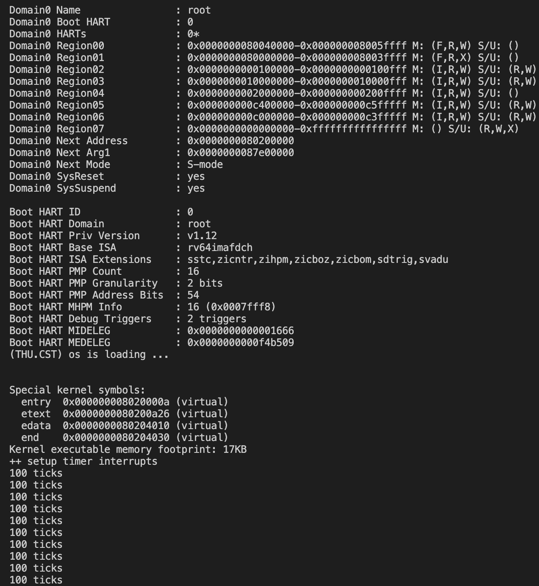
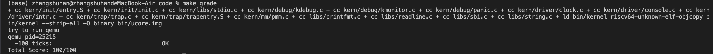

# 操作系统实验报告

## 实验基本信息

| 项目 | 内容 |
|------|------|
| **实验名称** | Lab X: [实验名称] |
| **小组成员** | 学号1-姓名1、学号2-姓名2、学号3-姓名3 |
| **完成日期** | YYYY-MM-DD |

### 小组分工

练习如何分工？

| 成员 | 负责的练习/模块 |
|------|----------------|
| 学号1-姓名1 | [练习或模块名称] |
| 学号2-姓名2 | [练习或模块名称] |
| 学号3-姓名3 | [练习或模块名称] |

实验报告如何分工？

---

## 一、实验目的

<!-- 说明本次实验的主要目标和预期成果 -->

本实验的主要目的是：

1. [目的1：例如，理解用户态进程如何通过系统调用进入内核]
2. [目的2：例如，掌握进程创建、执行、退出的完整生命周期]
3. [目的3：例如，学习使用 AI 辅助开发操作系统核心功能]

---

## 二、实验环境

你们使用的 AI 工具

| 成员 | AI 编程工具 | 底层模型 | 备注 |
|------|------------|---------|------|
| 学号1-姓名1 | [例如：Cline（VS Code插件） / Claude Code（终端 Agent） / DeepSeek Harness等] | [例如：Claude Sonnet 4.5 / GPT-5.5 / DeepSeek-V4-Flash等] | [可选：特殊配置等] |
| 学号2-姓名2 | | | |
| 学号3-姓名3 | | | |

**说明：**
- **AI 编程工具**：指具体使用的终端工具、编辑器插件、桌面应用或浏览器界面
- **底层模型**：指该工具使用的大语言模型及版本

---

## 三、实验整体逻辑分析

### 2.1 本章节的逻辑主线

[请用自己的话描述本章实验的核心主线，例如：
- 本章围绕哪个核心主题展开？（例如：用户进程管理、虚拟内存、文件系统等）
- 整个实验解决什么问题？（例如：如何让用户程序运行在操作系统之上）]

### 2.2 功能的逐步实现

[说明本章实验是按照什么顺序逐步实现各个功能的，以及为什么要按这个顺序，例如：

1. 首先实现**功能A** → 为什么首先实现这个？（例如：建立系统调用接口是后续所有用户态功能的基础）
2. 接着再完善**功能B** → 为什么接着实现这个？（例如：有了系统调用后，需要能够加载和启动第一个用户进程）
3. 然后完成**功能C** → 为什么然后实现这个？（例如：有了第一个进程后，需要实现进程复制功能）
4. 最后补充了**功能D** → 为什么最后实现这个？（例如：最后完善进程退出和清理机制，形成完整闭环）]

---

## 四、实验内容与实现

### 功能模块一：Trap 上下文恢复与 Trap 入口功能

**负责人：** 2413157-张书晗

#### 模块功能描述

**需要实现/修改的函数：**

```asm
.macro RESTORE_ALL          /* kern/trap/trapentry.S */
.globl __alltraps           /* 补全 SAVE_ALL 之后到 trap() 的衔接 */
```

**功能说明：**

- 作用：在 `SAVE_ALL` 把 Trap 现场压成栈上 `struct trapframe` 之后，把该帧按 RISC-V 调用约定交给 C 侧 `trap(struct trapframe *tf)`；`trap()` 返回后再由 `RESTORE_ALL` 恢复现场，最后 `sret` 回到被打断的执行流。
- 主要场景：时钟中断等 S 态 Trap 反复进出内核；异常处理若改写了 `tf->epc`/`tf->status`，恢复路径必须把最终值写回 CSR。
- 交互关系：依赖已提供的 `SAVE_ALL` 与 `struct trapframe` 布局；向上对接 `trap()` / `trap_dispatch()`；向下对接 `__trapret` 中的 `sret`。本模块不负责中断/异常的具体分类处理。

#### 最终提示词

````markdown
[PROMPT]
**任务**：修改 `kern/trap/trapentry.S`，完成「Trap 上下文恢复与 Trap 入口」模块。
本模块负责在已有 `SAVE_ALL` 把 Trap 现场保存到当前内核栈上的 `struct trapframe` 之后，建立汇编入口与 C 语言 `trap(struct trapframe *tf)` 的正确调用关系，并实现与 `SAVE_ALL` 对应的 `RESTORE_ALL`，使系统形成完整闭环：
Trap 进入 → 上下文保存 → C 语言处理 → 上下文恢复 → `sret` 返回原执行流。

**操作要求**：
- 必须在项目中修改实际文件 `kern/trap/trapentry.S`，而不是仅展示代码片段。
- 保留文件中现有代码；只补全 `RESTORE_ALL` 宏，以及 `__alltraps` 中 `SAVE_ALL` 之后、`__trapret` 之前需要补全的位置。
- 不得修改已提供的 `SAVE_ALL` 宏语义（仅允许工具链兼容的 CSR 别名替换）。
- 不得修改 `struct trapframe` / `struct pushregs` 的布局与定义，不得修改 `void trap(struct trapframe *tf)` 的函数签名。
- 不得改动 `__trapret` 中已有的 `RESTORE_ALL` 调用与随后的 `sret` 控制流结构。
- 不得引入与本模块无关的功能（时钟处理、异常分类等属于其他模块）。

**输出要求**：
- 直接进行文件操作。
- 以工程真实代码及下列 [RELY]、[GUARANTEE]、[SPECIFICATION] 为准。

[RELY]
#if __riscv_xlen == 64
# define STORE    sd
# define LOAD     ld
# define LOG_REGBYTES 3
#else
# define STORE    sw
# define LOAD     lw
# define LOG_REGBYTES 2
#endif
#define REGBYTES (1 << LOG_REGBYTES)

struct trapframe {
    struct pushregs gpr;   // 0..31 * REGBYTES
    uintptr_t status;      // 32
    uintptr_t epc;         // 33
    uintptr_t badvaddr;    // 34，对应 sbadaddr/stval（同 CSR 0x143）
    uintptr_t cause;       // 35
};

// SAVE_ALL：原始 sp 进 sscratch → 下移 36*REGBYTES → 存 x0/x1/x3..x31 →
// 把 sscratch 中的原始 sp 写入偏移 2 → 存 sstatus/sepc/stval/scause。
// 结束后当前 sp 即 trapframe 指针。

void trap(struct trapframe *tf);

[GUARANTEE]
必须补全：RESTORE_ALL 宏；__alltraps 中 SAVE_ALL 之后对 trap() 的调用衔接。
禁止修改 trap() 签名、trapframe 布局、__trapret 的 RESTORE_ALL+sret 顺序。

[SPECIFICATION]
## RESTORE_ALL
**Pre-Condition**: sp 指向完整 trapframe（可能已被 trap() 更新）。
**Post-Condition**: 通用寄存器与 sstatus/sepc 恢复为帧中最终值；x2(sp) 从 gpr.sp 恢复且必须最后恢复；可安全 sret。
**Case 1**: 与 SAVE_ALL 互逆恢复；先 CSR，再通用寄存器，最后 sp。
**Requirements**: 不与 SAVE_ALL 布局冲突；不规定唯一指令序列。

## __alltraps
**Pre-Condition**: SAVE_ALL 后 sp 指向 trapframe。
**Post-Condition**: 以 a0 传递 trapframe 指针并调用 trap()；返回后进入 __trapret。
**Case 1**: move a0,sp；jal trap。
**Requirements**: 遵守 RISC-V 调用约定；不破坏后续恢复所需信息。
````

#### 实现迭代过程

---

##### 第一次迭代

按提示词生成并写入 `RESTORE_ALL` 与 `__alltraps` 代码（`move a0, sp` + `jal trap`；先恢复 `sstatus/sepc`，再恢复通用寄存器，最后 `LOAD x2`）。

**遇到的问题：**
- 问题1：编译失败。`csrr s3, sbadaddr` 报错 `unknown CSR 'sbadaddr'`。原因：我本机 GNU as 2.47 不识别旧别名 `sbadaddr`，该 CSR 现名 `stval`。

**问题解决策略：**
在 `SAVE_ALL` 中将 `sbadaddr` 改为 `stval`。

---

##### 第二次迭代

**遇到的问题：**
- 编译已通过，但 `make grade` 得 0 分：串口只有 OpenSBI，内核未启动。
- 原因：QEMU 的新版 OpenSBI 下，旧参数 `-device loader,file=bin/ucore.img,addr=0x80200000` 无法正确设置跳转地址。

**问题解决策略：**
将 `Makefile` 的 `qemu`/`debug` 与评分脚本 `qemuopts` 改为 `-kernel bin/kernel`。

---

##### 第三次迭代

**最终结果：**

`make grade` 输出 `100 ticks: OK`，`Total Score: 100/100`，功能符合预期：Trap 可反复进入 `__alltraps` → `trap()` → `RESTORE_ALL` → `sret`

**关键改进点总结：**
1. 在 [RELY] 中明确 `x2(sp)` 特殊保存方式，以及 `sbadaddr/stval` 同 CSR。
2. 在 [SPECIFICATION] 中强调先恢复 `sstatus/sepc`，且 `sp` 必须最后恢复。

---

### 功能模块二：

**负责人：** 


---

### Challenge：[Challenge标题]

**负责人：** [学号-姓名]

[按照Challenge的具体要求进行解答]

---

## 五、测试与验证

**测试说明：**
- 编译：`make` 生成 `bin/kernel` / `bin/ucore.img` 成功。
- 运行：内核打印 `(THU.CST) os is loading ...`、`++ setup timer interrupts`，随后连续输出 10 次 `100 ticks`。
- 评分：`make grade` → `-100 ticks: OK`，`Total Score: 100/100`。

**测试截图：**

综合结果：

`make qemu` / 评分脚本串口输出（内核侧）：



`make grade` 结果：



---

## 六、实验总结与收获

### 对操作系统的理解

1. 列出你们认为本实验中重要的知识点，以及与对应的 OS 原理中的知识点，并简要说明二者的含义、关系和差异
2. 列出你们认为 OS 原理中很重要、但在本实验中没有对应上的知识点

### AI 协作开发的经验

[写出你们在与 AI 协作过程中实际收获的经验或者感悟]

---

