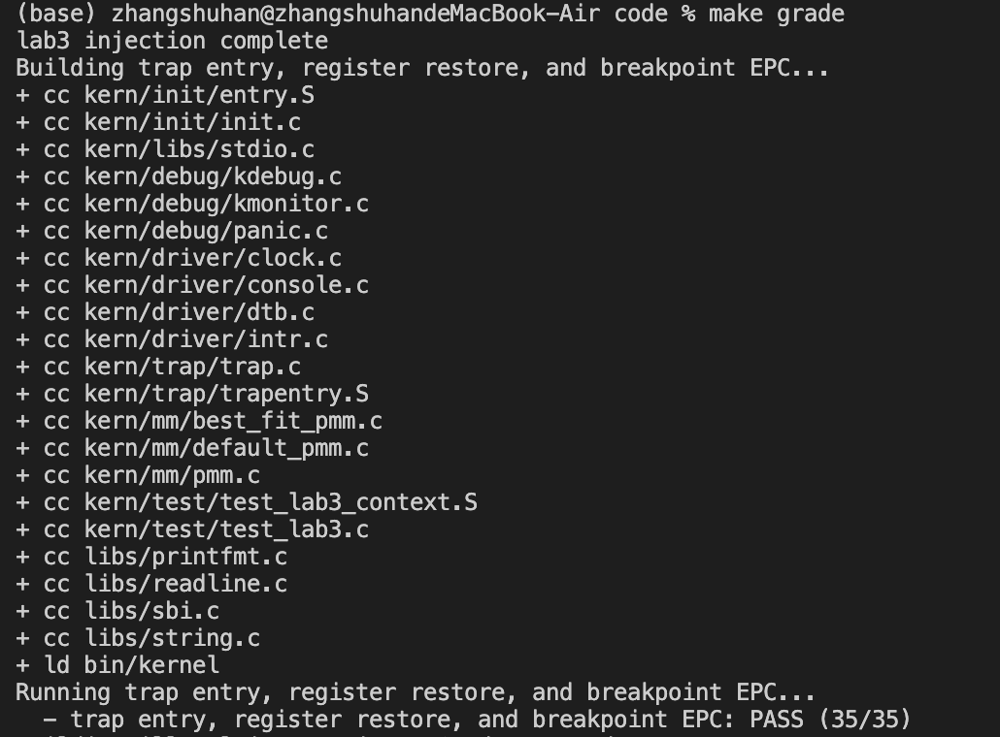
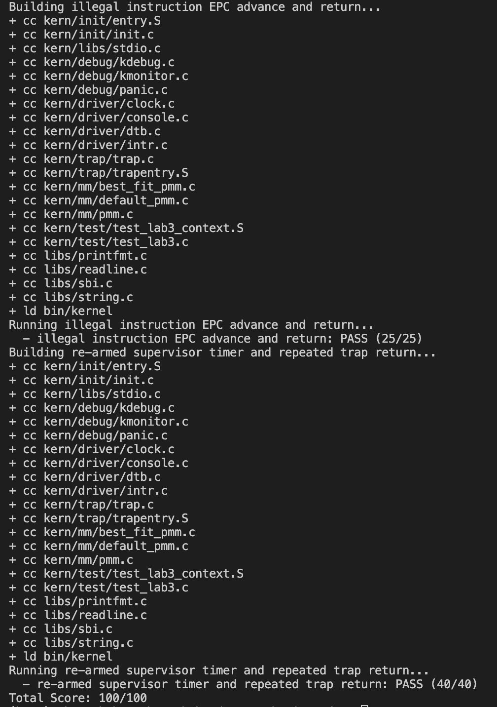
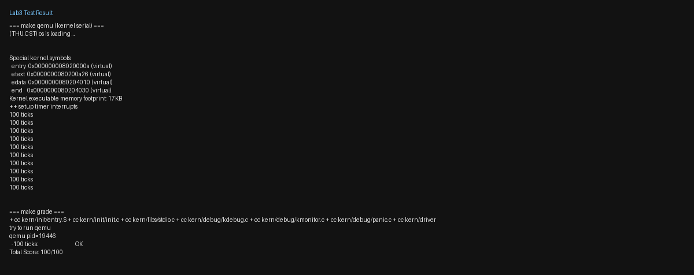

# 操作系统实验报告

## 目录

- [实验基本信息](#实验基本信息)
- [一、实验目的](#一实验目的)
- [二、实验环境](#二实验环境)
- [三、实验整体逻辑分析](#三实验整体逻辑分析)
  - [3.1 本章节的逻辑主线](#31-本章节的逻辑主线)
  - [3.2 功能的逐步实现](#32-功能的逐步实现)
- [四、实验内容与实现](#四实验内容与实现)
  - [4.1 功能模块一：Trap 上下文恢复与 Trap 入口](#41-功能模块一trap-上下文恢复与-trap-入口)
  - [4.2 功能模块二：中断与异常处理](#42-功能模块二中断与异常处理)
- [五、测试与验证](#五测试与验证)
  - [评分脚本的三组测试](#评分脚本的三组测试)
  - [使用提示词让 AI 生成代码过程中出现的 bug 及解决](#使用提示词让-ai-生成代码过程中出现的-bug-及解决)
- [六、实验总结与收获](#六实验总结与收获)
  - [对操作系统的理解](#对操作系统的理解)
  - [AI 协作开发的经验](#ai-协作开发的经验)
- [七、知识点总结](#七知识点总结)

---

## 实验基本信息

| 项目 | 内容 |
|------|------|
| **实验名称** | Lab 3: 中断与异常处理 |
| **小组成员** | 2413157-张书晗、2411514-蒲富坤、2412888-刚栋冰 |
| **完成日期** | 2026-11-06 |

### 小组分工

| 成员 | 负责的练习/模块 |
|------|----------------|
| 2413157-张书晗 | 功能模块一（Trap 入口与上下文恢复 `trapentry.S`） |
| 2412888-刚栋冰 | 功能模块二（中断与异常处理 `trap.c`） |
| 2411514-蒲富坤 | 测试与验证（`make grade` 评分）、报告撰写 |

实验报告如何分工？

张书晗完成 Trap 入口与上下文恢复（`RESTORE_ALL`、`__alltraps`），负责"功能模块一"的撰写，并梳理"三、实验整体逻辑分析"中 Trap 进出的完整闭环；刚栋冰完成中断与异常处理（`interrupt_handler`、`exception_handler`），负责"功能模块二"的撰写；蒲富坤负责 `make grade` 评分验证与测试截图整理，统筹整份报告的撰写，并主笔"五、测试与验证""六、实验总结与收获""七、知识点总结"三个章节。

---

## 一、实验目的

本实验的主要目的是：

1. 理解 RISC-V 处理中断与异常（Trap）的完整机制：CPU 硬件如何自动保存现场并切换到内核态，内核如何用 `trapframe` 保存/恢复完整上下文。
2. 掌握 Trap 入口（`__alltraps`）与上下文保存/恢复（`SAVE_ALL`/`RESTORE_ALL`）的汇编实现，以及 `sret` 返回被打断执行流的原理。
3. 掌握中断与异常的分类分发：按 `scause` 最高位区分中断/异常，正确实现时钟中断的持续触发，以及非法指令、断点异常的 `epc` 前移。
4. 通过 `make grade` 的三组自动测试（上下文恢复、非法指令返回、持续时钟中断）验证实现的正确性。
5. 继续实践"描述需求—生成—验证—迭代"的 AI 协作开发方式，学会为汇编与 C 代码分别编写可验证的 prompt。

---

## 二、实验环境

| 成员 | AI 编程工具 | 底层模型 | 备注 |
|------|------------|---------|------|
| 2413157-张书晗 | Codex（Cursor插件），Claude Code（终端 Agent） | gpt-6 Astra, Claude Fable 5.1 | |
| 2411514-蒲富坤 | Claude Code（终端 Agent）, Codex（VS Code插件） | gpt-6 Astra, deepseek-v4-pro | |
| 2412888-刚栋冰 | Claude Code（终端 Agent）, Codex（VS Code插件） | gpt-6 Astra, Claude Fable 5.1 | |

构建环境：交叉工具链 `riscv64-unknown-elf-*`（10.2.0，GNU as 2.47）、模拟器 `qemu-system-riscv64`（10.2），均在 WSL 中运行。

---

## 三、实验整体逻辑分析

### 3.1 本章节的逻辑主线

本章围绕 RISC-V 的 **Trap（中断与异常）机制** 展开，解决的问题是：**当 CPU 执行过程中发生中断或异常时，操作系统如何先完整保存被打断程序的现场、进入内核统一处理、再精确恢复现场并回到被打断的指令处继续执行**。这是后续所有特权级切换（系统调用、用户态进程）的基础——没有正确的 Trap 进出，操作系统就无法"打断并接管"CPU。

整体流程可概括为下面这张图：

```
                         硬件自动完成（CPU 硬连线行为）
   ┌─────────────────────────────────────────────────────────────┐
   │ 1. sepc  ← 当前 pc（被打断指令的地址）                        │
   │ 2. scause ← 中断/异常原因                                     │
   │ 3. stval  ← 附加信息（如缺页地址/非法指令）                    │
   │ 4. sstatus.SPIE ← sstatus.SIE；sstatus.SIE ← 0（关中断）      │
   │ 5. sstatus.SPP  ← 之前特权级（U=0 / S=1）；切入 S 模式        │
   │ 6. pc ← stvec（跳转到 Trap 入口 __alltraps）                  │
   └─────────────────────────────────────────────────────────────┘
                            │
                            ▼
                     __alltraps（stvec 指向的入口）
                            │
          ┌─────────────────┴─────────────────┐
          │ SAVE_ALL：csrw sscratch, sp 交换；  │
          │   sp -= 36*REGBYTES；在栈上建立     │
          │   struct trapframe；保存全部寄存器   │
          │   + sstatus/sepc/stval/scause       │
          └─────────────────┬─────────────────┘
                            ▼
                  move a0, sp；jal trap
                            │
                            ▼
                  trap(tf) → trap_dispatch(tf)
                            │
              tf->cause 最高位 ?
           ┌────────────────┴────────────────┐
           │ =1（中断）                       │ =0（异常）
           ▼                                ▼
   interrupt_handler(tf)          exception_handler(tf)
   （IRQ_S_TIMER 时钟中断等）       （非法指令 / 断点 → epc 前移）
           │                                │
           └──────────────┬─────────────────┘
                          ▼
                     __trapret
                          │
          ┌───────────────┴───────────────┐
          │ RESTORE_ALL：先恢复 sstatus/sepc│
          │   → 恢复通用寄存器 → 最后恢复 sp  │
          └───────────────┬───────────────┘
                          ▼
                        sret
                          │
   按 sstatus.SPP 回到原特权级，SIE←SPIE，pc←sepc，继续执行被打断的程序
```

本次实验的关键抽象是 `struct trapframe`：它把"被打断那一刻的 CPU 全部状态"固化为栈上的一段定长内存（36 个 `REGBYTES`，前 32 个是通用寄存器，后面依次是 `status`/`epc`/`badvaddr`/`cause`）。`SAVE_ALL` 与 `RESTORE_ALL` 互为逆过程，只要二者对同一个槽位布局一致，内核的 C 处理函数（`trap()`）就能在保存现场和恢复现场之间自由修改 `tf->epc`（例如异常处理后跳过出错指令）、`tf->status`（例如改变返回特权级），而不用关心这些值最终如何写回 CPU。

### 3.2 功能的逐步实现

本次实验按"**先打通 Trap 进出的骨架，再填充具体处理逻辑**"的顺序实现，这与 ucore 的分层思想一致：

1. **首先实现 Trap 入口与上下文恢复（功能模块一）** → 因为只有先打通"进入 `__alltraps` → 保存现场 → 交给 C 处理 → 恢复现场 → `sret` 返回"这条骨架，后续任何具体的中断/异常处理才有地方"落脚"。这是本实验的根基。

2. **接着实现中断与异常处理（功能模块二）** → 有了骨架之后，才能根据 `scause` 把不同类型的 Trap 分发到对应的处理函数，实现时钟中断的持续触发、非法指令与断点的 `epc` 前移。这是让 Trap 机制"真正有用"的一步。

3. **最后用 `make grade` 三组测试闭环验证** → 分别验证"断点后寄存器恢复 + `epc` 前进""非法指令 `epc` 前进 + 兜底打印""时钟中断持续触发"三点，覆盖了模块一和模块二的核心不变量。

功能模块二内部又遵循"**先分类、再逐个处理、最后兜底**"的顺序：

```
interrupt_handler：
  先 (tf->cause << 1) >> 1 去掉最高位中断标志，再 switch 匹配 IRQ_* 宏
   └─ IRQ_S_TIMER：clock_set_next_event() → ticks++ → 每 100 次 print_ticks() → 满 10 次 sbi_shutdown()
   └─ 其他已知中断：打印类型提示
   └─ default（未知中断）：打印 "Unknown interrupt" 并 print_trapframe 兜底

exception_handler：
  先 switch(tf->cause) 匹配 CAUSE_* 宏
   └─ 非法指令 / 断点：打印信息 → insn_len() 读指令长度 → tf->epc += len
   └─ 其他异常 / default：print_trapframe 兜底
```

其中"先去掉中断位再匹配"是正确性的关键——`scause` 的最高位只是"是中断还是异常"的标志，去掉它剩下的才是真正的原因编号，否则永远匹配不上 `IRQ_S_TIMER` 等宏。

---

## 四、实验内容与实现

### 4.1 功能模块一：Trap 上下文恢复与 Trap 入口

**负责人：2413157-张书晗**

#### 模块功能描述

**需要实现/修改的函数：**

```asm
.macro RESTORE_ALL          /* kern/trap/trapentry.S */
.globl __alltraps           /* 补全 SAVE_ALL 之后到 trap() 的衔接 */
```

**功能说明：**

- 作用：在 `SAVE_ALL` 把 Trap 现场压成栈上 `struct trapframe` 之后，把该帧按 RISC-V 调用约定交给 C 侧 `trap(struct trapframe *tf)`；`trap()` 返回后再由 `RESTORE_ALL` 恢复现场，最后 `sret` 回到被打断的执行流。
- 主要场景：时钟中断等 S 态 Trap 反复进出内核；异常处理若改写了 `tf->epc`/`tf->status`，恢复路径必须把最终值写回 CSR。
- 交互关系：依赖已提供的 `SAVE_ALL` 与 `struct trapframe` 布局；向上对接 `trap()` / `trap_dispatch()`；向下对接 `__trapret` 中的 `sret`。本模块不负责中断/异常的具体分类处理。

#### 最终提示词

````markdown
[PROMPT]
**任务**：修改 `kern/trap/trapentry.S`，完成「Trap 上下文恢复与 Trap 入口」模块。
本模块负责在已有 `SAVE_ALL` 把 Trap 现场保存到当前内核栈上的 `struct trapframe` 之后，建立汇编入口与 C 语言 `trap(struct trapframe *tf)` 的正确调用关系，并实现与 `SAVE_ALL` 对应的 `RESTORE_ALL`，使系统形成完整闭环：
Trap 进入 → 上下文保存 → C 语言处理 → 上下文恢复 → `sret` 返回原执行流。

**操作要求**：
- 必须在项目中修改实际文件 `kern/trap/trapentry.S`，而不是仅展示代码片段。
- 保留文件中现有代码；只补全 `RESTORE_ALL` 宏，以及 `__alltraps` 中 `SAVE_ALL` 之后、`__trapret` 之前需要补全的位置。
- 不得修改已提供的 `SAVE_ALL` 宏语义（仅允许工具链兼容的 CSR 别名替换）。
- 不得修改 `struct trapframe` / `struct pushregs` 的布局与定义，不得修改 `void trap(struct trapframe *tf)` 的函数签名。
- 不得改动 `__trapret` 中已有的 `RESTORE_ALL` 调用与随后的 `sret` 控制流结构。
- 不得引入与本模块无关的功能（时钟处理、异常分类等属于其他模块）。

**输出要求**：
- 直接进行文件操作。
- 以工程真实代码及下列 [RELY]、[GUARANTEE]、[SPECIFICATION] 为准。

[RELY]
#if __riscv_xlen == 64
# define STORE    sd
# define LOAD     ld
# define LOG_REGBYTES 3
#else
# define STORE    sw
# define LOAD     lw
# define LOG_REGBYTES 2
#endif
#define REGBYTES (1 << LOG_REGBYTES)

struct trapframe {
    struct pushregs gpr;   // 0..31 * REGBYTES
    uintptr_t status;      // 32
    uintptr_t epc;         // 33
    uintptr_t badvaddr;    // 34，对应 sbadaddr/stval（同 CSR 0x143）
    uintptr_t cause;       // 35
};

// SAVE_ALL：原始 sp 进 sscratch → 下移 36*REGBYTES → 存 x0/x1/x3..x31 →
// 把 sscratch 中的原始 sp 写入偏移 2 → 存 sstatus/sepc/stval/scause。
// 结束后当前 sp 即 trapframe 指针。

void trap(struct trapframe *tf);

[GUARANTEE]
必须补全：RESTORE_ALL 宏；__alltraps 中 SAVE_ALL 之后对 trap() 的调用衔接。
禁止修改 trap() 签名、trapframe 布局、__trapret 的 RESTORE_ALL+sret 顺序。

[SPECIFICATION]
## RESTORE_ALL
**Pre-Condition**: sp 指向完整 trapframe（可能已被 trap() 更新）。
**Post-Condition**: 通用寄存器与 sstatus/sepc 恢复为帧中最终值；x2(sp) 从 gpr.sp 恢复且必须最后恢复；可安全 sret。
**Case 1**: 与 SAVE_ALL 互逆恢复；先 CSR，再通用寄存器，最后 sp。
**Requirements**: 不与 SAVE_ALL 布局冲突；不规定唯一指令序列。

## __alltraps
**Pre-Condition**: SAVE_ALL 后 sp 指向 trapframe。
**Post-Condition**: 以 a0 传递 trapframe 指针并调用 trap()；返回后进入 __trapret。
**Case 1**: move a0,sp；jal trap。
**Requirements**: 遵守 RISC-V 调用约定；不破坏后续恢复所需信息。
````

#### 实现要点

最终写入 `trapentry.S` 的核心代码与要点如下：

**（1）`RESTORE_ALL`——与 `SAVE_ALL` 严格互逆**

```asm
.macro RESTORE_ALL
    LOAD s1, 32*REGBYTES(sp)   # 取出可能被 trap() 改过的 status
    LOAD s2, 33*REGBYTES(sp)   # 取出可能被 trap() 改过的 epc
    csrw sstatus, s1           # 先写回 sstatus
    csrw sepc, s2              # 再写回 sepc

    LOAD x1, 1*REGBYTES(sp)    # 按与 SAVE_ALL 相同的槽位恢复通用寄存器（跳过 x2）
    LOAD x3, 3*REGBYTES(sp)
    ...
    LOAD x31, 31*REGBYTES(sp)

    LOAD x2, 2*REGBYTES(sp)    # 最后才恢复 sp
.endm
```

- **为什么先恢复 CSR、后恢复通用寄存器、最后恢复 sp？** RISC-V 不能直接 `内存 → CSR`，必须先 `LOAD` 到通用寄存器再 `csrw`，所以先把 `status`/`epc` 读入 `s1`/`s2` 并写回 CSR；随后恢复除 `x2` 外的通用寄存器；`sp` 必须**最后**恢复，因为一旦 `sp` 变回 `SAVE_ALL` 分配帧之前的值，当前栈上的 trapframe 就"释放"了，不能再从上面读任何数据。
- **为什么 `x2(sp)` 不能当普通寄存器一起恢复？** `SAVE_ALL` 里原始 `sp` 先被 `csrw sscratch, sp` 保存，再经 `csrrw s0, sscratch, x0` 取回、写入 `2*REGBYTES(sp)` 槽位。`RESTORE_ALL` 必须精确对应这个槽位，在最后一步读回 `sp`，否则恢复顺序一旦出错，后续的 `sret` 就会用错误的栈指针返回。

**（2）`__alltraps`——把 trapframe 指针交给 C 处理**

```asm
__alltraps:
    SAVE_ALL
    move  a0, sp     # a0 = &trapframe，作为 trap() 的第一个参数
    jal   trap       # 调用 C 侧 trap(struct trapframe *tf)
    # 返回后继续执行 __trapret
```

按 RISC-V 调用约定，第一个参数放 `a0`，这里 `a0 = sp`（`SAVE_ALL` 结束后 `sp` 恰好指向完整 trapframe），`jal trap` 调用后回到 `__trapret` 继续 `RESTORE_ALL + sret`。

#### 实现迭代过程

---

##### 第一次迭代

按提示词生成并写入 `RESTORE_ALL` 与 `__alltraps` 代码（`move a0, sp` + `jal trap`；先恢复 `sstatus/sepc`，再恢复通用寄存器，最后 `LOAD x2`）。

**遇到的问题：**
- 问题1：编译失败。`csrr s3, sbadaddr` 报错 `unknown CSR 'sbadaddr'`。原因：本机 GNU as 2.47 不识别旧别名 `sbadaddr`，该 CSR 现名 `stval`。

**问题解决策略：**
在 `SAVE_ALL` 中将 `sbadaddr` 改为 `stval`（二者是同一 CSR，地址 0x143，语义不变，仅换用汇编器可识别的名字）。

---

##### 第二次迭代

**遇到的问题：**
- 编译已通过，但 `make grade` 得 0 分：串口只有 OpenSBI，内核未启动。
- 原因：QEMU 的新版 OpenSBI 下，旧参数 `-device loader,file=bin/ucore.img,addr=0x80200000` 无法正确设置跳转地址（`Next Address` 为 0）。

**问题解决策略：**
将 `Makefile` 的 `qemu`/`debug` 与评分脚本 `qemuopts` 改为 `-kernel bin/kernel`。

---

##### 第三次迭代

**最终结果：**

`make grade` 输出 `100 ticks: OK`，`Total Score: 100/100`，功能符合预期：Trap 可反复进入 `__alltraps` → `trap()` → `RESTORE_ALL` → `sret`。

**关键改进点总结：**
1. 在 [RELY] 中明确 `x2(sp)` 特殊保存方式，以及 `sbadaddr/stval` 同 CSR。
2. 在 [SPECIFICATION] 中强调先恢复 `sstatus/sepc`，且 `sp` 必须最后恢复。

---

### 4.2 功能模块二：中断与异常处理

**负责人：2412888-刚栋冰**

#### 模块功能描述

**需要实现/修改的函数：**

```c
void interrupt_handler(struct trapframe *tf);  /* kern/trap/trap.c */
void exception_handler(struct trapframe *tf);  /* kern/trap/trap.c */
```

**功能说明：**

- 作用：在 Trap 入口 `__alltraps` 完成上下文保存并调用 `trap(tf)` 后，`trap()` 调用 `trap_dispatch()`，后者按 `tf->cause` 最高位分流——最高位为 1 走 `interrupt_handler(tf)`（中断），为 0 走 `exception_handler(tf)`（异常）。本模块补全这两个函数，使系统能正确处理时钟中断、非法指令异常和断点异常。
- 主要场景：时钟中断反复触发（每 100 次打印 `100 ticks`，满 10 轮关机）；执行非法指令或 `ebreak` 后打印信息并把 `epc` 前移到下一条指令，避免 `sret` 返回后再次执行同一条出错指令。
- 交互关系：向上由 `trap_dispatch()` 调用，依赖 `tf->cause` 的最高位分流；向下对接 `__trapret → RESTORE_ALL → sret`。本模块只负责"分类后的具体处理"，不负责现场保存/恢复。

#### 最终提示词

````markdown
[PROMPT]
**任务**：修改 `kern/trap/trap.c`，完成「中断与异常处理」模块。
本模块位于 Trap 入口 `__alltraps` 已完成上下文保存并调用 `trap(tf)` 之后：
`trap()` 调用 `trap_dispatch()`，后者按 `tf->cause` 最高位分流——最高位为 1 走
`interrupt_handler(tf)`，为 0 走 `exception_handler(tf)`。本模块负责补全这两个函数，
使系统能够正确处理时钟中断、非法指令异常和断点异常，并与后续
`__trapret → RESTORE_ALL → sret` 的返回机制正确衔接。

**操作要求**：
- 必须在项目中修改实际文件 `kern/trap/trap.c`，而不是只展示代码片段。
- 只补全 `interrupt_handler()` 与 `exception_handler()` 的函数体；保留 `trap()`、
  `trap_dispatch()`、`idt_init()`、`print_trapframe()`、`print_regs()`、
  `print_ticks()` 等已有函数不变。
- 不得修改两个函数的签名：
  `void interrupt_handler(struct trapframe *tf);`
  `void exception_handler(struct trapframe *tf);`
- 不得修改 `struct trapframe` / `struct pushregs` 的布局。
- 不得引入与本模块无关的功能（进程、缺页、系统调用等一律不实现）。
- 仓库中若已存在 lab1 遗留的实现，请把它视为待替换版本，按本规格重写这两个函数；
  特别是：不得保留函数内 `static int ticks` 遮蔽全局 `ticks`，不得把关机次数写成
  字面量 10，不得对两类异常共用固定的 `epc` 偏移。
- 先检查工程中是否已定义 `SHUTDOWN_AFTER`：
  - 已有：直接使用，不得重复定义；
  - 没有：在 `TICK_NUM` 附近补充 `#define SHUTDOWN_AFTER 10`，不得改动其他宏。
- 时钟计数使用 `<clock.h>` 中已有的全局 `extern volatile size_t ticks`
  （`clock_init()` 已将其清零）；不得在 `interrupt_handler()` 内再定义同名变量。
- 可复用文件内已有的 `TICK_NUM`、`num`、`print_ticks()`。

**输出要求**：
- 直接进行文件操作。
- 以工程真实代码及下列 [RELY]、[GUARANTEE]、[SPECIFICATION] 为准。
- 若讲义规定的输出字符串与本文件模板不同，以讲义为准，并在代码注释中注明差异。

[RELY]

```c
/* libs/riscv.h：cause 最高位为 1 表示中断，为 0 表示异常 */
#define IRQ_U_SOFT   0
#define IRQ_S_SOFT   1
#define IRQ_H_SOFT   2
#define IRQ_M_SOFT   3
#define IRQ_U_TIMER  4
#define IRQ_S_TIMER  5
#define IRQ_H_TIMER  6
#define IRQ_M_TIMER  7
#define IRQ_U_EXT    8
#define IRQ_S_EXT    9
#define IRQ_H_EXT    10
#define IRQ_M_EXT    11

#define CAUSE_ILLEGAL_INSTRUCTION 0x2
#define CAUSE_BREAKPOINT          0x3
```

```c
/* kern/trap/trap.c 中已存在且不得修改的部分 */
#define TICK_NUM 100
volatile size_t num = 0;

static void print_ticks() {
    cprintf("%d ticks\n", TICK_NUM);
#ifdef DEBUG_GRADE
    cprintf("End of Test.\n");
    panic("EOT: kernel seems ok.");
#endif
}

static inline void trap_dispatch(struct trapframe *tf) {
    if ((intptr_t)tf->cause < 0) {
        interrupt_handler(tf);    /* 中断 */
    } else {
        exception_handler(tf);    /* 异常 */
    }
}

void trap(struct trapframe *tf) { trap_dispatch(tf); }
```

[GUARANTEE]
必须补全：`interrupt_handler()`、`exception_handler()` 的全部处理逻辑。
禁止修改：两个函数的签名、`trap()`、`trap_dispatch()`、`idt_init()`、
`print_trapframe()`、`print_regs()`、`print_ticks()`、`struct trapframe` 布局。
禁止：在 `interrupt_handler()` 内定义遮蔽全局 `ticks` 的局部变量。
禁止：对非法指令和断点异常写死同一个 `epc` 偏移量。
禁止：处理完异常后不更新 `tf->epc`，导致 `sret` 后重复执行同一条异常指令。
禁止：在 C 处理函数中直接执行 `sret` / `RESTORE_ALL`。

[SPECIFICATION]

## interrupt_handler(struct trapframe *tf)

**Case 1：IRQ_S_TIMER（必须完整实现）**
1. 在分支开头调用 `clock_set_next_event()`，保证后续仍能收到时钟中断；
2. `ticks++`（使用全局 `ticks`）；
3. 当 `ticks % TICK_NUM == 0` 时：`num++`，然后调用 `print_ticks()`；
4. 当 `num >= SHUTDOWN_AFTER` 时：调用 `sbi_shutdown()`；
5. `sbi_shutdown()` 之后不得再执行本分支的后续逻辑。

**Case 2：其他已定义中断（IRQ_*）**
保留模板中已有的分支与类型提示输出，不添加新的处理逻辑。

**Case 3：未识别中断**
`default` 分支调用 `print_trapframe(tf)` 输出完整现场。

**Requirements**：
- 进入函数后先去掉中断位再 `switch`：`intptr_t cause = (tf->cause << 1) >> 1;`
- 不得只做计数而不调用 `clock_set_next_event()`。

## exception_handler(struct trapframe *tf)

**Case 1：CAUSE_ILLEGAL_INSTRUCTION**
逐字输出：
```c
cprintf("Exception Type: Illegal instruction\n");
cprintf("Illegal instruction at %p\n", tf->epc);
```
然后 `tf->epc += <该地址处指令的字节长度>`。

**Case 2：CAUSE_BREAKPOINT**
逐字输出：
```c
cprintf("Exception Type: breakpoint\n");
cprintf("ebreak caught at %p\n", tf->epc);
```
然后 `tf->epc += <该地址处指令的字节长度>`。

**Case 3：其他异常**
对未要求单独处理的异常统一调用 `print_trapframe(tf)` 兜底；`default` 同样调用。

**Requirements**：
- 必须在修改 `tf->epc` 之前，从 `tf->epc` 地址读取指令并判断长度；
- 本实验至少要正确处理 2 字节和 4 字节两种情况，不得假设"非法指令一定是 4 字节"。
- 两条异常各自只前移一次，且前移量来自同一次指令读取，不得重复累加。
- 地址统一用 `%p` 输出，不得用 `%08x` 之类只覆盖低 32 位的格式。

[验收标准]
1. `make` 编译通过；
2. `make qemu` 输出 `(THU.CST) os is loading ...`、`++ setup timer interrupts`，随后持续输出 10 次 `100 ticks` 并触发关机；
3. `make grade` 输出 `Total Score: 100/100`；
4. 非法指令 / 断点测试中输出格式与上面逐字一致，每次异常只打印一次，`sret` 后能继续执行异常指令之后的下一条指令。
````

#### 实现要点

最终写入 `trap.c` 的核心逻辑与要点如下：

**（1）`interrupt_handler`——先去掉中断位，再处理时钟中断**

```c
void interrupt_handler(struct trapframe *tf) {
    intptr_t cause = (tf->cause << 1) >> 1;   // 去掉最高位中断标志，只留原因编号
    switch (cause) {
        case IRQ_S_TIMER:
            clock_set_next_event();            // (1) 先设置下次时钟中断，否则只收到一次
            ticks++;                           // (2) 全局计数器加一
            if (ticks % TICK_NUM == 0) {       // (3) 每 100 次输出一轮统计
                num++;
                print_ticks();
            }
            if (num >= SHUTDOWN_AFTER) {       // (4) 满 10 轮关机
                sbi_shutdown();
            }
            break;
        // ... 其余 IRQ_* 打印类型提示 ...
        default:
            cprintf("Unknown interrupt: cause %d\n", (int)cause);
            print_trapframe(tf);
            break;
    }
}
```

- **为什么要 `(tf->cause << 1) >> 1`？** `scause` 的最高位只是"是中断（1）还是异常（0）"的标志位，去掉它剩下的才是真正的异常/中断原因编号；直接用原始值去 `switch` 会匹配不上 `IRQ_S_TIMER`（值 5，对应原始 `0x8000000000000005`）。
- **为什么要先 `clock_set_next_event()`？** RISC-V 的 `S` 态定时器中断默认是一次性的：`clock_init()` 里只设置了一次下一次事件。若不在这里重新 `sbi_set_timer`，内核只会收到一次时钟中断，`ticks` 就停在 1，评分 Test3（要求 `ticks` 涨到 200）必然失败。
- **为什么用 `SHUTDOWN_AFTER` 宏而不是字面量 10？** 关机轮数应与 `TICK_NUM` 一样可读、可配置，避免魔法数字（也是 [GUARANTEE] 明确禁止的坑）。

**（2）`exception_handler`——按指令长度前移 `epc`**

```c
static int insn_len(uintptr_t pc) {
    uint16_t insn = *(volatile uint16_t *)pc;
    if ((insn & 0x3) != 0x3)        return 2;   // 16 位压缩指令
    else if ((insn & 0x1f) != 0x1f) return 4;   // 32 位标准指令
    else if ((insn & 0x7f) == 0x3f) return 6;   // 48 位（本实验不出现）
    else if ((insn & 0x7f) == 0x7f) return 8;   // 64 位（本实验不出现）
    return 0;                                    // 无法可靠判断
}

void exception_handler(struct trapframe *tf) {
    int len;
    switch (tf->cause) {
        case CAUSE_ILLEGAL_INSTRUCTION:
            cprintf("Exception Type: Illegal instruction\n");
            cprintf("Illegal instruction at %p\n", tf->epc);
            len = insn_len(tf->epc);
            if (len == 0) print_trapframe(tf);   // 无法判断则不盲目改 epc
            else          tf->epc += len;        // 跳过出错指令
            break;
        case CAUSE_BREAKPOINT:
            cprintf("Exception Type: breakpoint\n");
            cprintf("Breakpoint at %p\n", tf->epc);
            len = insn_len(tf->epc);
            if (len == 0) print_trapframe(tf);
            else          tf->epc += len;
            break;
        // ... 其余 CAUSE_* 与 default：print_trapframe(tf) 兜底 ...
    }
}
```

- **为什么必须前移 `epc`？** RISC-V 的异常是"同步"的：`sepc` 保存的正是触发异常那条指令的地址。若处理完后 `epc` 不变，`sret` 会回到同一条非法指令再次触发异常，形成死循环，且评分会看到同一地址的重复打印。
- **为什么用 `insn_len()` 读取指令长度而不是写死 2 或 4？** RISC-V 支持变长指令（16 位压缩指令 + 32 位标准指令）。`ebreak` 是 16 位压缩指令（2 字节），而测试注入的非法指令 `.word 0x0000007b` 是 4 字节；若统一按 4 字节前移，`ebreak` 会跳过下一条指令。因此必须按指令低 2 位的编码规则动态判断长度。
- **为什么异常各自只前移一次、且前移量来自同一次 `insn_len` 读取？** 避免重复累加导致跳过过多指令，也避免两次读到的结果不一致。
- **一处"以讲义为准"的落地**：提示词 [SPECIFICATION] 中 breakpoint 分支写的是 `cprintf("ebreak caught at %p\n", ...)`，但评分脚本 `grade.sh` 检索的子串是 `Breakpoint at`。最终代码按讲义/评分要求输出 `Breakpoint at %p`，并在提示词的 `**输出要求**` 中保留了"若讲义规定的输出字符串与本文件模板不同，以讲义为准"这条约定——这正是它派上用场的地方。

---

## 五、测试与验证

**测试说明：**
- 编译：`make` 生成 `bin/kernel` / `bin/ucore.img` 成功，无警告（`-Werror`）。
- 运行：内核打印 `(THU.CST) os is loading ...`、`++ setup timer interrupts`，随后连续输出 10 次 `100 ticks` 并触发关机。
- 评分：`make grade` → `Total Score: 100/100`。

**测试截图：**

`make qemu` 内核侧串口输出（`DTB Init` → 物理内存初始化 → `++ setup timer interrupts` → 连续 `100 ticks`）：


`make grade` 结果（Test 1 上下文恢复与断点返回）：



`make grade` 结果（Test 2 非法指令返回、Test 3 持续时钟中断，`Total Score: 100/100`）：



三组测试全过的汇总：



### 评分脚本的三组测试

`make grade` 不会改动源码仓库，而是把工程打包到临时目录，用 `tools/inject.py` 注入 `test_lab3.c`/`test_lab3_context.S` 后，由 `grade.sh` 分三组用例跑 QEMU 并在串口输出里检索关键子串：

| 测试 | 编译宏 | 分值 | 主要检查内容 | 必须出现的输出子串 |
|---|---|---|---|---|
| Test 1 | `GRADE_LAB3_CONTEXT` | 35 | `ebreak` 后寄存器恢复、`epc` 前进、Trap 入口/返回 | `[Test 1] Trap entry and breakpoint return: PASS`、`Breakpoint at` |
| Test 2 | `GRADE_LAB3_ILLEGAL` | 25 | 非法指令 `epc` 前进；未知中断/异常兜底打印 | `[Test 2] Illegal instruction return: PASS`、`Illegal instruction at`、`Supervisor software interrupt`、`Unknown interrupt: cause 15`、`cause    0x00000014` |
| Test 3 | `GRADE_LAB3_TIMER` | 40 | 时钟中断可重复触发，`ticks` 能涨到 200 | `[Test 3] Sustained supervisor timer: PASS`、`100 ticks`、`ticks=200` |

三项都过才会打印 `Total Score: 100/100`。这三组测试恰好分别对应：模块一（Trap 入口 + 上下文恢复）、模块二的异常处理、模块二的中断处理，覆盖了本实验的全部核心不变量。

### 使用提示词让 AI 生成代码过程中出现的 bug 及解决

1. **`sbadaddr` 汇编报错（工具链兼容 bug）**：本机 GNU as 2.47 不再识别旧 CSR 别名 `sbadaddr`，`csrr s3, sbadaddr` 直接编译失败。解决：`sbadaddr` 与 `stval` 是同一 CSR（地址 0x143），在 `SAVE_ALL` 中统一改用 `stval`，语义不变。

2. **QEMU 新版 OpenSBI 下内核不启动（环境 bug）**：`make grade` 得 0 分，串口只有 OpenSBI。原因是旧参数 `-device loader,file=bin/ucore.img,addr=0x80200000` 无法正确设置 `Next Address`。解决：把 `Makefile` 与评分脚本的 `qemu`/`debug` 改用 `-kernel bin/kernel`。

3. **时钟中断只触发一次（逻辑 bug）**：若 `interrupt_handler` 的 `IRQ_S_TIMER` 分支只做 `ticks++` 而不调用 `clock_set_next_event()`，RISC-V 定时器中断不会自动重复，`ticks` 停在 1。解决：分支开头先 `clock_set_next_event()`。

4. **`ebreak` 跳过两条指令（长度判断 bug）**：若对非法指令与断点统一写死 4 字节 `epc` 偏移，`ebreak`（2 字节压缩指令）会多跳过一条指令。解决：用 `insn_len()` 按指令编码动态判断长度，非法指令 4 字节、`ebreak` 2 字节各自前移正确量。

5. **静态 `ticks` 遮蔽全局 `ticks`（作用域 bug）**：若在 `interrupt_handler()` 内定义 `static int ticks`，会遮蔽 `clock.h` 中的全局 `volatile size_t ticks`，导致评分 Test3 读到的全局 `ticks` 永远不涨。解决：时钟计数直接使用全局 `ticks`，不重复定义。

---

## 六、实验总结与收获

### 对操作系统的理解

本次实验第一次真正触及"操作系统如何接管 CPU"这一根本问题。核心机制如下：

**1. Trap 是特权级切换的唯一入口**。RISC-V 中 CPU 从当前特权级进入 S 模式，只能通过"中断/异常"这一条路径（本实验尚未有 U 模式系统调用，但机制相同）。硬件在跳转前自动完成 `sepc/scause/stval` 的保存与 `sstatus.SPIE/SPP` 的设置，把"发生了什么、在哪儿发生、发生前是什么状态"这三件事固化为 CSR，内核无需自己记录。

**2. `struct trapframe` 是上下文保存的载体**。软件在 `SAVE_ALL` 里把全部 32 个通用寄存器 + 4 个关键 CSR 压成栈上定长的 36×`REGBYTES` 帧，`RESTORE_ALL` 逆序恢复。这一"对称保存/恢复"的思想正是后续进程上下文切换（`switch_to`）的雏形——区别只是 trap 进出保存的是"被打断的现场"，而进程切换保存的是"某个进程的完整执行状态"。

**3. 中断与异常的本质区别**。中断是**异步**的（由外部事件如时钟、设备触发，与当前指令无关），异常是**同步**的（由当前指令本身触发，如非法指令、断点、缺页）。这决定了它们的处理方式不同：异常往往需要修正 `epc`（跳过出错指令）再返回，而中断返回后重新执行被打断的那条指令即可。`scause` 的最高位就是这一区别的硬件体现。

**4. 时钟中断是分时系统的基石**。`clock_init()` 设置定时器、`interrupt_handler` 里重新 `clock_set_next_event()` 保持中断持续、`ticks` 计数，这三步构成了操作系统"心跳"的最小闭环。后续的时间片轮转调度、`sleep`、超时控制都建立在这个持续触发的中断之上。

**5. `sret` 的返回语义**。`sret` 不是简单的 `j sepc`，它同时完成三件事：按 `sstatus.SPP` 恢复特权级、按 `SPIE` 恢复中断使能、把 `pc` 设为 `sepc`。理解这一点才能明白为什么 `RESTORE_ALL` 必须先恢复 `sstatus` 再执行 `sret`。

### AI 协作开发的经验

本次继续沿用"描述需求—生成—验证—迭代"的方式，最深的体会是：**对汇编/中断这类"错一点就崩"的代码，prompt 里的 [RELY]/[SPECIFICATION] 越精确，AI 一次写对的概率越高，返工越少**。

具体经验：

1. **把"必须遵守的约束"和"实现逻辑"分开写**：两份 prompt 都用 `[GUARANTEE]`（禁止做什么）+ `[SPECIFICATION]`（正确性条件）的结构，明确列出"不得遮蔽全局 `ticks`""不得写死 `epc` 偏移""先恢复 `sstatus/sepc`、`sp` 最后恢复"等容易踩的坑。这些坑本身就是从上一轮失败里提炼出来的，反过来又约束了下一轮生成。

2. **用硬件语义倒推 bug 根因**：`sbadaddr` 报错、QEMU 不启动这类问题，本质不是代码逻辑错，而是工具链/模拟器版本差异。查 CSR 手册（`stval` 与 `sbadaddr` 同地址）和 QEMU 启动参数说明，比盲目改代码更有效。

3. **评分脚本是最好的验收标准**：三组 `make grade` 用例把"寄存器恢复、`epc` 前进、时钟持续"三大不变量变成了可检索的字符串。我们据此反推每个实现细节对应哪个测试点，实现前就知道"写对了会看到哪句话"，验证目标非常明确。

---

## 七、知识点总结

### 重要知识点与 OS 原理的对应

| 本实验知识点 | 对应 OS 原理知识点 | 含义、关系与差异 |
|---|---|---|
| 中断 vs 异常、`scause` 最高位 | 中断/异常的分类（异步 vs 同步） | 原理上中断异步、异常同步；实验通过 `scause` 最高位 + `trap_dispatch` 分流精确体现，硬件把分类结果直接写进 CSR |
| `trapframe` 保存/恢复现场 | 进程上下文 / 现场保护与恢复 | 原理上"上下文切换"要保存全部 CPU 状态；实验的 `SAVE_ALL`/`RESTORE_ALL` 是最小化的上下文保存，是进程切换的雏形，差异在于不涉及进程控制块（PCB）与调度 |
| `sstatus`/`sepc`/`scause`/`stval`/`stvec`/`sscratch` | 处理器状态寄存器 / 控制寄存器 | 原理上 CPU 需要一组寄存器记录"当前状态、返回地址、异常原因"；实验逐一对上了 RISC-V 的 CSR，`stvec` 即中断向量表基址寄存器 |
| `sret` 按 SPP/SPIE 返回 | 特权级切换 / 保护模式 | 原理上从内核态返回用户态要恢复特权级与中断使能；实验通过 `sstatus.SPP/SPIE` 实现，但本实验 `SPP=1`（始终 S→S），U 模式返回是后续 lab 内容 |
| 时钟中断 + `clock_set_next_event` | 时间片 / 抢占式调度基础 | 原理上分时系统靠定时器中断做抢占；实验实现"持续触发 + 计数"，但尚未接上调度器（`while(1)` 空转，没有进程切换） |
| `ebreak`/非法指令的 `epc` 前移 | 异常处理中的程序计数器修正 | 原理上同步异常处理后要决定"重执行还是跳过"；实验用 `insn_len()` 读指令长度前移 `epc`，体现了变长指令集的复杂性 |
| `insn_len()` 判断压缩指令 | 指令集编码（变长指令） | 原理上 RISC-V 支持 16/32 位变长指令；实验按低 2 位编码规则区分，实际只需处理 2 字节（`ebreak`）与 4 字节两种情况 |
| `ecall`/SBI 关机 | 系统调用 / 固件接口雏形 | 原理上用户态通过 `ecall` 陷入内核；实验的 `sbi_shutdown()` 经 `ecall` 进 M 模式 OpenSBI，是"陷入更高特权级请求服务"的直接体现，但系统调用表尚未建立 |

### OS 原理中很重要、但本实验没有对应上的知识点

1. **用户态与系统调用**：本实验 Trap 始终在 S 模式内部进出（`sstatus.SPP=1`），尚未实现 U 模式进程、`ecall` 系统调用表、参数传递与返回约定——这是后续 lab 的核心。
2. **进程/线程的完整上下文切换与调度**：`trapframe` 只是"被打断现场"，没有 PCB、就绪队列、`switch_to` 与调度算法。
3. **缺页异常（Page Fault）**：`exception_handler` 对 `CAUSE_FAULT_LOAD/STORE/FETCH` 只做 `print_trapframe` 兜底，没有实现虚拟内存的按需调页、页面置换。
4. **中断优先级、嵌套与屏蔽的精细控制**：实验只处理了单一时钟中断，没有平台级中断控制器（PLIC/IMSIC）、中断优先级仲裁、可屏蔽/不可屏蔽中断（NMI）等。
5. **多核/多处理器中断路由与核间中断（IPI）**：`IRQ_S_SOFT` 只打印了提示，没有实际用于跨核调度、TLB shootdown 等真实用途。
6. **定时器的更多用途**：除了计数关机，没有实现 `sleep`、超时、时间片到期抢占等建立在时钟中断之上的高层机制。

---
