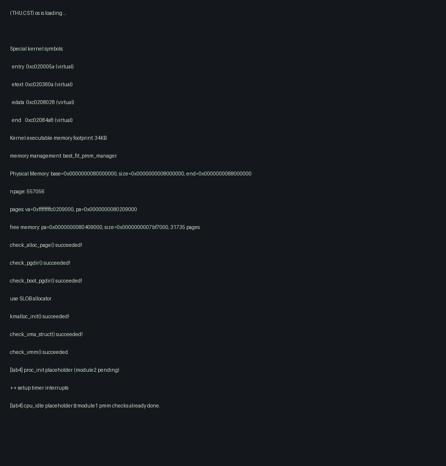

# 操作系统实验报告

## 实验基本信息

| 项目 | 内容 |
|------|------|
| **实验名称** | Lab X: [实验名称] |
| **小组成员** | 学号1-姓名1、学号2-姓名2、学号3-姓名3 |
| **完成日期** | YYYY-MM-DD |

### 小组分工

练习如何分工？

| 成员 | 负责的练习/模块 |
|------|----------------|
| 学号1-姓名1 | [练习或模块名称] |
| 学号2-姓名2 | [练习或模块名称] |
| 学号3-姓名3 | [练习或模块名称] |

实验报告如何分工？

---

## 一、实验目的

<!-- 说明本次实验的主要目标和预期成果 -->

本实验的主要目的是：

1. [目的1：例如，理解用户态进程如何通过系统调用进入内核]
2. [目的2：例如，掌握进程创建、执行、退出的完整生命周期]
3. [目的3：例如，学习使用 AI 辅助开发操作系统核心功能]

---

## 二、实验环境

你们使用的 AI 工具

| 成员 | AI 编程工具 | 底层模型 | 备注 |
|------|------------|---------|------|
| 学号1-姓名1 | [例如：Cline（VS Code插件） / Claude Code（终端 Agent） / DeepSeek Harness等] | [例如：Claude Sonnet 4.5 / GPT-5.5 / DeepSeek-V4-Flash等] | [可选：特殊配置等] |
| 学号2-姓名2 | | | |
| 学号3-姓名3 | | | |

**说明：**
- **AI 编程工具**：指具体使用的终端工具、编辑器插件、桌面应用或浏览器界面
- **底层模型**：指该工具使用的大语言模型及版本

---

## 三、实验整体逻辑分析

### 2.1 本章节的逻辑主线

[请用自己的话描述本章实验的核心主线，例如：
- 本章围绕哪个核心主题展开？（例如：用户进程管理、虚拟内存、文件系统等）
- 整个实验解决什么问题？（例如：如何让用户程序运行在操作系统之上）]

### 2.2 功能的逐步实现

[说明本章实验是按照什么顺序逐步实现各个功能的，以及为什么要按这个顺序，例如：

1. 首先实现**功能A** → 为什么首先实现这个？（例如：建立系统调用接口是后续所有用户态功能的基础）
2. 接着再完善**功能B** → 为什么接着实现这个？（例如：有了系统调用后，需要能够加载和启动第一个用户进程）
3. 然后完成**功能C** → 为什么然后实现这个？（例如：有了第一个进程后，需要实现进程复制功能）
4. 最后补充了**功能D** → 为什么最后实现这个？（例如：最后完善进程退出和清理机制，形成完整闭环）]

---

## 四、实验内容与实现

<!-- 
说明：本部分按照 exercises 文档中的练习顺序组织
每个功能模块或者练习中可能包含多项任务，请根据实际情况调整
-->

### 功能模块一：虚拟内存页操作功能

**负责人：** 2413157-张书晗

#### 模块功能描述

**需要实现/修改的函数：**

```c
int page_insert(pde_t *pgdir, struct Page *page, uintptr_t la, uint32_t perm); // kern/mm/pmm.c
void page_remove(pde_t *pgdir, uintptr_t la);                                 // kern/mm/pmm.c
```

**功能说明：**

- 本模块在已有多级页表框架上完成最基本的映射维护：把物理页挂到指定线性地址，以及把已有映射安全撤销。
- `page_insert` 建立或更新映射；`page_remove` 删除映射。二者共同决定线性地址最终对应哪一页物理内存，并保持「页表项内容、物理页引用计数、TLB 状态」三者同步。
- 主要场景：首次建映射、同页更新权限、替换为其他物理页、`get_pte(..., create=1)` 分配中间页表失败返回 `-E_NO_MEM`、以及无映射时 `page_remove` 幂等返回。
- 与其他模块关系：依赖已实现的 `get_pte` / `pte_create` / `tlb_invalidate` 与物理页分配器；为后续页表测试、内核映射检查和线程地址空间逻辑提供基础。本实验以 `/Volumes/T7/lab4_new` 框架为底（而非直接在 lab3 分支上改），并把 lab2/lab3 代码填回标注位置。

#### 最终提示词

以下是经过迭代优化后，最终成功实现该功能的提示词：

````markdown
[PROMPT]
**任务**：修改 `kern/mm/pmm.c`（如声明需同步则同时修改 `kern/mm/pmm.h`），完成「虚拟内存页操作」功能模块。
本模块在已有多级页表框架上提供最基本的映射维护能力：把指定物理页挂到给定线性地址上，以及把已有映射安全撤销。
`page_insert` 负责建立或更新映射，`page_remove` 负责删除映射；二者共同决定某一线性地址最终对应哪一页物理内存，并保证物理页引用计数、页表项内容与 TLB 状态三者一致。

**操作要求**：
- 必须在项目中修改实际文件，而不是仅展示代码片段。
- 保留文件中现有代码；只在 `page_insert` / `page_remove`（及确有必要时的模块内辅助函数）的标记或空实现位置补全。
- 不得修改 `get_pte()` 的既有语义与签名（可调用，不可改写其行为约定）。
- 不得改动物理内存分配器接口的对外契约。
- 不得引入与本模块无关的功能。

**输出要求**：
- 直接进行文件操作。
- 以工程真实代码及下列 `[RELY]`、`[GUARANTEE]`、`[SPECIFICATION]` 为准。

[RELY]
#define PTE_V 0x001
#define PTE_R 0x002
#define PTE_W 0x004
#define PTE_U 0x010
#define E_NO_MEM 4
typedef uintptr_t pte_t;
typedef uintptr_t pde_t;
struct Page { int ref; uint64_t flags; unsigned int property; list_entry_t page_link; };
pte_t *get_pte(pde_t *pgdir, uintptr_t la, bool create);
pte_t pte_create(uintptr_t ppn, uint32_t perm);
struct Page *pte2page(pte_t pte);
page_ref / set_page_ref / page_ref_inc / page_ref_dec
alloc_page / free_page
tlb_invalidate / flush_tlb

[GUARANTEE]
必须实现：
```c
int page_insert(pde_t *pgdir, struct Page *page, uintptr_t la, uint32_t perm);
void page_remove(pde_t *pgdir, uintptr_t la);
```
允许添加 static 辅助函数（如 page_remove_pte）。

[SPECIFICATION]
## page_insert
**Pre-Condition**: pgdir/page/la/perm 合法；可用 get_pte(...,1) 定位或创建末级 PTE。
**Post-Condition**: 成功则 la 映射到 page 且权限为 perm，引用计数与 TLB 同步；失败返回 -E_NO_MEM 且不留半完成映射。
**Case 1**: 无旧映射 → 新建映射，ref++，TLB 失效，返回 0。
**Case 2**: 已映射到同一 page → 更新权限，引用计数自洽，TLB 失效，返回 0。
**Case 3**: 已映射到其他 page → 先撤销旧映射再建立新映射，引用计数与 check_pgdir 可观察行为一致。
**Case 4**: 无法获得末级 PTE → 返回 -E_NO_MEM。
**Requirements**: 页表项、引用计数、TLB 三者同步；只描述行为不规定唯一实现步骤。

## page_remove
**Pre-Condition**: 不假定 la 一定有有效映射。
**Post-Condition**: 有映射则删除并同步 ref/TLB；无映射则安静返回（幂等）。
````

#### 实现迭代过程

本模块的实现经历了 2 次关键迭代，过程如下：

---

##### 第一次迭代

按上述提示词生成 `page_insert` / `page_remove`（含 static `page_remove_pte`），并迁入 lab2 的 `page_init`、Best-Fit，以及 lab3 的 trap 入口/处理代码。

**遇到的问题：**
- 问题1：本机 QEMU 使用框架默认 `-device loader` 时 OpenSBI Next Address 为 0，内核进不去；改为 `-kernel` 后仍因 lab4 原始 `entry.S` 缺少 0x80000000 恒等映射与虚址跳转而在开启 Sv39 后取指死循环。
- 问题2：`check_pgdir()` 已通过，但 `check_boot_pgdir()` 在 `strcpy((void*)0x100, ...)` 处整机重启。根因是框架 `get_pte` 给非叶页表项设置了 `PTE_U`，违反 RISC-V「非叶项 R/W/X/U 必须为 0」的约定，硬件页表行走失败。

**问题解决策略：**
- 针对问题1：迁入 lab3 已验证的 `entry.S` 恒等映射 + `.Lvirt_entry` 跳转，并修正 Makefile/`grade.sh` 的 QEMU 启动参数（环境/启动问题，不改提示词主体）。
- 针对问题2：将非叶项改为 `pte_create(ppn, 0)`；同步把 `check_pgdir` 中对 `boot_pgdir_va[0] & PTE_U` 的断言改为检查 `PTE_V`。这属于保留真实硬件语义的修正，与提示词中「TLB/页表一致性」要求一致。

---

##### 第二次迭代

**最终结果：**

经过 2 次迭代，该模块最终：
- ✅ 编译通过（`make`）
- ✅ `check_alloc_page` / `check_pgdir` / `check_boot_pgdir` 全部 succeeded
- ✅ `kmalloc_init` / `check_vmm` 通过；随后进入模块二占位的 `proc_init`（模块二/三尚未用提示词实现）

**关键改进点总结：**
1. 在实现中用 static `page_remove_pte` 统一「撤映射 + 降引用 + TLB 失效」，对应提示词 Case 3 与 `page_remove` 幂等要求。
2. 明确非叶 PTE 不得带 `PTE_U`，否则 `check_boot_pgdir` 的真实 MMU 访问会失败——这是提示词「保留真实语义」在 RISC-V 上的具体落地。
3. 验证阶段以框架自带 `check_pgdir`/`check_boot_pgdir` 为准；完整 `make grade` 还需后续完成模块二/三。

---

### 功能模块二：进程创建及初始化功能

**负责人：** 2411514-蒲富坤

#### 模块功能描述

**需要实现/修改的函数：**

```c
static struct proc_struct *alloc_proc(void);                                        // kern/process/proc.c
void proc_init(void);                                                               // kern/process/proc.c
int kernel_thread(int (*fn)(void *), void *arg, uint32_t clone_flags);              // kern/process/proc.c
int do_fork(uint32_t clone_flags, uintptr_t stack, struct trapframe *tf);           // kern/process/proc.c
static void copy_thread(struct proc_struct *proc, uintptr_t esp, struct trapframe *tf); // kern/process/proc.c
static int copy_mm(uint32_t clone_flags, struct proc_struct *proc);                 // kern/process/proc.c
```

**功能说明：**

- 本模块把内核从「已经能运行内核代码」推进到「已经能创建并登记多个内核线程」：`alloc_proc` 得到干净 PCB，`proc_init` 包装 idleproc 并创建 initproc，`kernel_thread` 整理线程首次运行所需的临时中断帧，`do_fork` 把内核栈、PID、链表、状态位等资源组合成可运行实体，`copy_thread` 布置 trapframe 与 context，`copy_mm` 承担地址空间处理的占位。
- 模块完成后系统里至少要存在 `idleproc` 与 `initproc` 两个关键线程，且 `initproc` 需能在后续调度中被真正切换执行。
- 关键难点是「线程生命周期状态」与「资源挂接顺序」保持一致：`alloc_proc` 必须把 PCB 置于安全空白态，避免后续误用未初始化字段；`proc_init` 中的 idleproc 直接复用当前执行现场（pid/内核栈/current 都有特殊含义）；`kernel_thread` 与 `copy_thread` 需配合 `forkret → forkrets → __trapret` 形成首次运行链路；`do_fork` 需正确处理失败清理、PID 分配、链表挂接与唤醒顺序，否则会出现资源泄漏、僵尸结构或状态错误。
- 与其他模块关系：依赖模块一的 `get_pte`/`boot_pgdir_pa` 与物理页分配器；为模块三的 `schedule`/`proc_run`/`switch_to` 提供可调度实体与首次运行现场。本模块完成后即可满足 `test_lab4_process_create` 的全部断言。

#### 最终提示词

以下是经过迭代优化后，最终成功实现该功能的提示词（完整版另存为 `lab4_module2_proc_create_prompt.md`）：

````markdown
[PROMPT]
**任务**：修改 `kern/process/proc.c`（如声明需同步则同时修改 `kern/process/proc.h`），完成「进程创建及初始化」功能模块。
本模块负责把系统中「已经能运行内核代码」推进到「已经能创建并登记多个内核线程」。`alloc_proc` 得到一个干净的进程控制块；`proc_init` 把当前执行现场包装成 idleproc 并创建第一个真正的内核线程 initproc；`kernel_thread` 把函数入口和参数整理成线程首次运行所需的临时中断帧；`do_fork` 把这些信息和内核栈、PID、链表、状态位等资源真正组合成一个可运行实体；`copy_thread` 把 trapframe 和 context 安放到新线程自己的内核栈上；`copy_mm` 在当前实验阶段承担地址空间处理接口的占位作用。

**操作要求**：
- 必须在项目中修改实际文件，而不是仅展示代码片段。
- 保留文件中现有代码；只在标记为「lab4」/「YOUR CODE」的占位位置补全。
- 不得修改 `get_pid` / `hash_proc` / `find_proc` / `setup_kstack` / `put_kstack` / `forkret` 等既有辅助函数的行为约定。
- 不得改动 `struct proc_struct`、`struct context`、`struct trapframe` 的字段定义。
- 不得引入与本模块无关的功能。

**输出要求**：
- 直接进行文件操作。
- 以工程真实代码及下列 `[RELY]`、`[GUARANTEE]`、`[SPECIFICATION]` 为准。

[RELY]
enum proc_state { PROC_UNINIT, PROC_SLEEPING, PROC_RUNNABLE, PROC_ZOMBIE };
#define PROC_NAME_LEN 15
#define MAX_PROCESS 4096
#define MAX_PID (MAX_PROCESS * 2)
#define KSTACKSIZE (2 * PGSIZE)
#define CLONE_VM 0x00000100
struct proc_struct { state, pid, runs, kstack, need_resched, parent, mm, context, tf, pgdir, flags, name, list_link, hash_link };
struct context { ra, sp, s0~s11 };
struct trapframe { gpr(struct pushregs), status, epc, badvaddr, cause };
extern struct proc_struct *idleproc, *initproc, *current;
extern char bootstack[], bootstacktop[];
extern uintptr_t boot_pgdir_pa;
kmalloc / kfree
alloc_pages / free_pages / page2kva / kva2page
get_pid / hash_proc / find_proc / set_proc_name / get_proc_name
setup_kstack / put_kstack / wakeup_proc / forkret / kernel_thread_entry / forkrets
list_init / list_add / list_next / le2proc
local_intr_save / local_intr_restore
read_csr(sstatus) / SSTATUS_SPP / SSTATUS_SPIE / SSTATUS_SIE
E_NO_MEM / E_NO_FREE_PROC

[GUARANTEE]
必须实现：
```c
static struct proc_struct *alloc_proc(void);
void proc_init(void);
int kernel_thread(int (*fn)(void *), void *arg, uint32_t clone_flags);
int do_fork(uint32_t clone_flags, uintptr_t stack, struct trapframe *tf);
static void copy_thread(struct proc_struct *proc, uintptr_t esp, struct trapframe *tf);
static int copy_mm(uint32_t clone_flags, struct proc_struct *proc);
```

[SPECIFICATION]
## alloc_proc
**Pre-Condition**: 无。
**Post-Condition**: 返回一块状态干净、字段已初始化的 PCB：state=PROC_UNINIT、pid=-1、runs=0、kstack=0、need_resched=0、parent=NULL、mm=NULL、context 清零、tf=NULL、pgdir=boot_pgdir_pa、flags=0、name 清零；内存不足返回 NULL。

## proc_init
**Pre-Condition**: pmm/vmm 已初始化；proc_list 与 hash_list 未初始化。
**Post-Condition**: proc_list 与 hash_list 初始化完毕；idleproc（pid=0、RUNNABLE、kstack=bootstack、need_resched=1、parent=NULL、mm=NULL、tf=NULL）与 initproc（pid=1、RUNNABLE、parent=idleproc、mm=NULL、context.ra 与 context.sp 非 0）都已建立，且 current=idleproc。

## kernel_thread
**Pre-Condition**: fn/arg 合法；进程系统已初始化。
**Post-Condition**: 构造临时中断帧（s0=fn、s1=arg、epc=kernel_thread_entry、status 置 SPP/SPIE 并清 SIE），调用 do_fork 返回新线程 pid 或负错误码。

## do_fork
**Pre-Condition**: 进程数未达上限。
**Post-Condition**: 依次完成 alloc_proc → setup_kstack → copy_mm → copy_thread → 挂 proc_list/hash_list（关中断）→ wakeup_proc 七步，返回子进程 pid；任一步失败则回滚已分配资源并返回负错误码。

## copy_thread
**Pre-Condition**: proc->kstack 已分配，tf 有效。
**Post-Condition**: trapframe 放到内核栈顶，a0=0，sp=esp（esp==0 时用栈顶），context.ra=forkret、context.sp=tf。

## copy_mm
**Pre-Condition**: current->mm == NULL。
**Post-Condition**: 本实验不做地址空间复制，返回 0。
````

#### 实现迭代过程

本模块的实现经历了 2 次关键迭代，过程如下：

---

##### 第一次迭代

按上述提示词生成 6 个函数，先落地「标准 7 步 do_fork + 内核栈顶布置 trapframe」的骨架。

**遇到的问题：**
- 问题1：`test_lab4_process_create` 在 `idleproc->context.ra == 0` 处断言失败。根因是 `alloc_proc` 未对 `context` 清零，残留了 kmalloc 未初始化的垃圾值。
- 问题2：`idleproc->kstack` 被误用 `setup_kstack` 分配了新页，导致 `idleproc->kstack == (uintptr_t)bootstack` 断言失败。idleproc 本应直接复用启动阶段已建立的 bootstack，而非像普通线程那样另分配内核栈。

**问题解决策略：**
- 针对问题1：在 `alloc_proc` 中用 `memset(&(proc->context), 0, sizeof(struct context))` 显式清零上下文，并同步清零 `tf`、`name`、`flags` 等字段。
- 针对问题2：`proc_init` 中把 `idleproc->kstack = (uintptr_t)bootstack`，并把 `need_resched` 置 1、`state` 置 `PROC_RUNNABLE`，使其成为「继承当前执行现场」的空闲线程而非新分配栈的线程。

---

##### 第二次迭代

**最终结果：**

经过 2 次迭代，该模块最终：
- ✅ 编译通过（`make`）
- ✅ `test_lab4_process_create` 断言全部满足（idleproc 与 initproc 的 pid/state/parent/context 等字段一致）
- ✅ `proc_init` 返回后 `current == idleproc`，`initproc` 已登记为 pid=1 的就绪线程，等待模块三调度

**关键改进点总结：**
1. 严格区分「idleproc 复用现场」与「initproc 经 do_fork 复制」两条创建路径：前者手动打 pid=0 / bootstack / need_resched，后者走完整 7 步 fork。
2. `copy_thread` 用 `(struct trapframe *)(proc->kstack + KSTACKSIZE) - 1` 把中断帧顶到内核栈顶，并设 `context.ra=forkret`、`context.sp=proc->tf`，保证首次切换能走 `forkret → forkrets → __trapret` 恢复链路。
3. `do_fork` 通过 `local_intr_save/restore` 保护「分配 pid + 挂链表 + nr_process++」这段临界区，失败路径按 kstack → proc 逆序回滚，避免泄漏。

---

## 五、测试与验证

本阶段验证范围：功能模块一（虚拟内存页操作）。在填好 lab2/lab3 依赖并实现 `page_insert`/`page_remove` 后执行 `make && make qemu`。

关键输出包括：
- `check_alloc_page() succeeded!`
- `check_pgdir() succeeded!`
- `check_boot_pgdir() succeeded!`
- `kmalloc_init() succeeded!` / `check_vmm() succeeded.`

说明：模块三仍为占位实现，故尚未跑通完整 `make grade` 的 Schedule 项；模块二的 Process Create 项已按 `test_lab4_process_create` 断言实现完成（见下）。

**模块一测试截图：**



完整文本日志见：`./images/qemu_module1.log`

---

### 模块二验证（进程创建及初始化）

本模块通过注入到 `proc_init` 末尾的 `test_lab4_process_create()` 进行验证，关键断言：

- `current == idleproc`；
- idleproc：`pid == 0`、`state == PROC_RUNNABLE`、`kstack == bootstack`、`parent == NULL`、`mm == NULL`、`tf == NULL`、`runs == 0`、`flags == 0`、`context.ra == 0`；
- initproc：`pid == 1`、`state == PROC_RUNNABLE`、`parent == idleproc`、`mm == NULL`、`context.ra != 0`、`context.sp != 0`。

`make grade` 对应检查项：`[Test Process Create] PASS`。

> 验证：已在 WSL（riscv64-unknown-elf-gcc 14.2.0 + qemu-system-riscv64）中编译并运行，`[Test Process Create] PASS` 通过。完整文本日志见：`./images/qemu_module2.log`。

---

## 六、实验总结与收获

### 对操作系统的理解

1. 列出你们认为本实验中重要的知识点，以及与对应的 OS 原理中的知识点，并简要说明二者的含义、关系和差异
2. 列出你们认为 OS 原理中很重要、但在本实验中没有对应上的知识点

### AI 协作开发的经验

[写出你们在与 AI 协作过程中实际收获的经验或者感悟]

---

